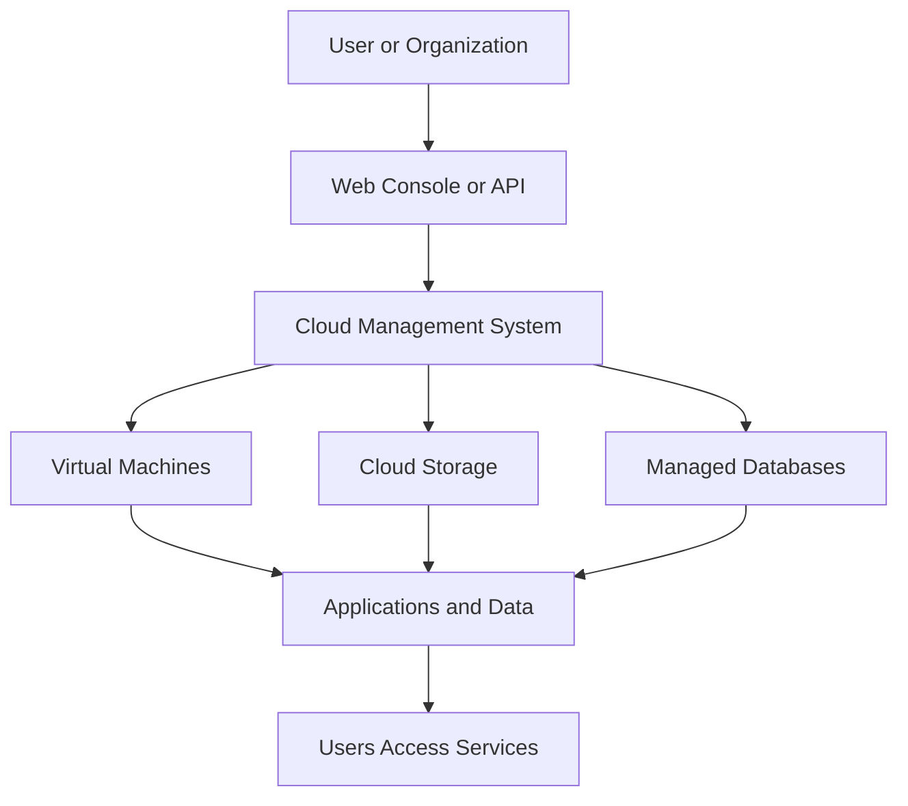
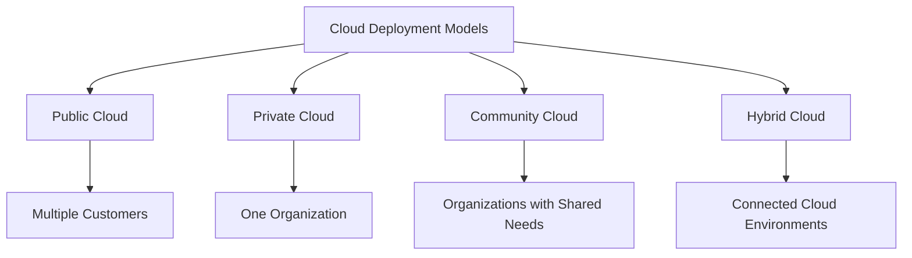
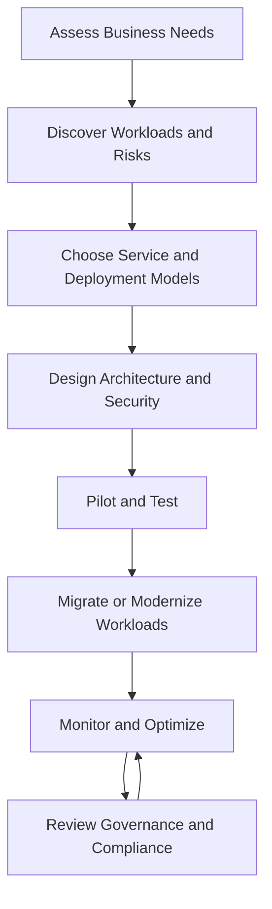

# ☁️ Cloud Computing Fundamentals — Cybersecurity Notes

> Cloud computing is the delivery of computing resources — such as servers, storage, databases, networking, and software — over a network, usually the internet, on demand. Instead of owning and maintaining all the hardware, organizations can use resources provided by a cloud service provider and pay according to their usage or subscription.

## 1. ☁️ What Is Cloud Computing?

### 🧠 Understanding the Concept

Imagine you want to store 1 TB of data.

- **Traditional computing:** You purchase a physical storage device, maintain it, and manage its security yourself.
- **Cloud computing:** You rent storage from a cloud provider and access it over a network without managing the underlying physical hardware.

The same idea applies to virtual machines, databases, applications, networking, and security services.

Cloud computing is not simply storing files online. It provides access to a wide range of configurable computing resources.

### ⚙️ How Cloud Computing Works

Cloud computing relies on several technologies:

- **Data centers:** Physical facilities containing servers, storage devices, and networking equipment.
- **Virtualization:** Technology that allows multiple virtual machines to share the resources of a physical server.
- **Networking:** Connects users, applications, and cloud resources.
- **Automation and orchestration:** Provision, configure, scale, and manage resources.
- **APIs and management consoles:** Allow users and applications to control cloud services programmatically or through a web interface.
- **Metering and billing:** Track resource consumption for usage-based pricing.

### 🔄 Cloud Computing Workflow

For example, a company can deploy a web application on cloud servers, store uploaded files in cloud storage, and use a managed database without purchasing its own physical servers.

### 🔑 Essential Characteristics

| Characteristic | Explanation | Example |
|---|---|---|
| On-demand self-service | Resources can be provisioned when needed. | Creating a virtual machine through a console. |
| Broad network access | Services are accessible over a network using supported devices and interfaces. | Accessing a cloud application from a laptop. |
| Resource pooling | A provider shares physical infrastructure among multiple customers while maintaining logical isolation. | Multiple customers using the same physical server. |
| Rapid elasticity | Resources can scale up or down as demand changes. | Adding application instances during a traffic spike. |
| Measured service | Usage can be monitored, measured, and billed. | Paying for storage consumed or computing time used. |

### 🖥️ Traditional Computing vs Cloud Computing

| Feature | Traditional On-Premises | Cloud Computing |
|---|---|---|
| Infrastructure | Organization owns or controls its physical equipment. | Provider supplies infrastructure in public-cloud models. |
| Initial investment | Often high hardware and setup costs. | Often lower initial infrastructure costs. |
| Scaling | May require purchasing and installing hardware. | Often possible through software-controlled provisioning. |
| Maintenance | Organization manages its infrastructure. | Responsibilities are divided between provider and customer. |
| Cost model | Capital expenditure and ongoing operating costs. | Often usage-based or subscription-based. |
| Control | Direct control over physical infrastructure. | Control depends on the service model and deployment. |

**Important:** Cloud computing does not automatically mean lower costs, better performance, or stronger security. These depend on architecture, configuration, workload, and management.

---

## 2. 🧱 Cloud Service Models

Cloud service models describe **how much of the computing environment the provider manages and how much the customer controls**.

The three foundational models are IaaS, PaaS, and SaaS.

### A. 🖥️ IaaS — Infrastructure as a Service

IaaS provides fundamental computing resources, such as virtual machines, networking, and storage.

The customer has significant control over the operating system and software environment.

**Examples:**
- Amazon EC2
- Azure Virtual Machines
- Google Compute Engine

**How it works:**

1. The customer provisions a virtual machine.
2. The provider manages the physical servers and virtualization infrastructure.
3. The customer configures the operating system, applications, users, and relevant security controls.
4. The customer monitors and maintains the software they are responsible for.

**Cybersecurity example:** A security engineer deploys a Linux virtual machine to host a log-analysis tool and configures firewall rules, SSH access, logging, and system updates.

**Advantages**
- Greater control over operating systems and configurations.
- Flexible environments for specialized workloads.
- Suitable for custom security tools and legacy applications.

**Limitations**
- Requires system administration skills.
- Misconfigured firewalls, permissions, or operating systems can expose the environment.
- The customer must manage more components than with higher-level services.

### B. 🛠️ PaaS — Platform as a Service

PaaS provides a managed application platform so developers can build and deploy applications without managing the underlying servers and operating systems directly.

**Examples:**
- Azure App Service
- Google App Engine
- Heroku

**How it works:**

1. Developers write application code.
2. They deploy it to the managed platform.
3. The provider manages much of the underlying infrastructure and runtime environment.
4. Developers focus primarily on application functionality, data, and application-level security.

**Cybersecurity example:** A developer deploys a login application on a managed platform. The platform handles much of the server maintenance, but the developer must still implement secure authentication, input validation, and appropriate access controls.

**Advantages**
- Faster application development and deployment.
- Less infrastructure maintenance.
- Built-in platform features may simplify scaling and monitoring.

**Limitations**
- Less control over the underlying environment.
- Possible vendor lock-in.
- Vulnerable application code and insecure configurations can still cause breaches.

### C. 🌐 SaaS — Software as a Service

SaaS delivers a complete application to users, usually through a web browser or application interface.

**Examples:**
- Microsoft 365
- Google Workspace
- Salesforce

**How it works:**

1. A provider operates the application and its underlying infrastructure.
2. Users access the application through supported interfaces.
3. The provider maintains the service, while customers manage their users, data, and available security settings.

**Cybersecurity example:** An organization uses a cloud email service. The provider maintains the email infrastructure, but the organization must configure multi-factor authentication, manage account permissions, and protect against phishing.

**Advantages**
- Minimal infrastructure management for customers.
- Quick access to ready-to-use software.
- Provider-managed updates and maintenance.

**Limitations**
- Less control over the application and infrastructure.
- Dependence on provider availability and policies.
- Account compromise, excessive permissions, and unsafe data sharing remain risks.

### 📊 IaaS vs PaaS vs SaaS

| Feature | IaaS | PaaS | SaaS |
|---|---|---|---|
| Main offering | Computing infrastructure | Application development platform | Complete software application |
| Customer primarily manages | OS, applications, data, and configurations | Application code, data, and application settings | Users, data, access, and available settings |
| Provider manages | Physical infrastructure and virtualization | Infrastructure, OS, and managed platform components | Application service and underlying infrastructure |
| Control | High | Moderate | Lower |
| Administrative effort | Higher | Moderate | Usually lower |
| Typical user | System administrator or infrastructure engineer | Application developer | End user or business team |

### 🪜 A Simple Analogy

Imagine three ways to use a kitchen:

- **IaaS:** You rent an equipped kitchen but manage the operating environment and prepare everything yourself.
- **PaaS:** You use a managed kitchen with essential equipment and services already maintained.
- **SaaS:** You order a prepared meal and simply use the finished service.

The analogy is simplified, but it illustrates the increasing level of management provided by the service provider.

**Remember:** Moving from IaaS to PaaS to SaaS generally reduces the customer's infrastructure-management burden, but also reduces direct control over the underlying environment.

---

## 3. 🏢 Cloud Deployment Models

Deployment models describe **where cloud infrastructure is located, who can use it, and how it is managed**.

### A. 🌍 Public Cloud

Public cloud infrastructure is provided by a cloud provider for use by multiple customers, with logical separation between their environments.

**Examples:** Amazon Web Services (AWS), Microsoft Azure, and Google Cloud.

**Advantages**
- Rapid provisioning and flexible scaling.
- No need to purchase the underlying physical infrastructure.
- Broad selection of managed services.

**Limitations**
- Less direct control over physical infrastructure.
- Security depends on both provider controls and customer configuration.
- Costs can increase unexpectedly without monitoring and governance.

**Use case:** A startup hosts its website and database on public-cloud services.

### B. 🏠 Private Cloud

A private cloud is dedicated to one organization. It may be hosted in the organization's own data center or by an external provider.

**Advantages**
- Greater control over infrastructure and configuration.
- Can support specialized compliance and isolation requirements.
- Allows an organization to customize its environment.

**Limitations**
- Can be expensive to build and operate.
- Requires skilled administration.
- Private infrastructure still needs patching, monitoring, backup, and incident response.

**Use case:** A financial institution uses a private cloud for workloads that require specialized control and governance.

**Important:** A private cloud is not automatically secure or compliant. Its security depends on implementation and management.

### C. 🤝 Community Cloud

A community cloud is shared by organizations with common requirements, such as regulatory obligations, security needs, or operational objectives.

**Advantages**
- Shared costs among participating organizations.
- Infrastructure can be designed around common requirements.
- Cooperation may simplify shared services and governance.

**Limitations**
- Governance and responsibility can be complicated.
- Organizations may disagree about policies or resource allocation.
- Shared infrastructure requires clear isolation and access controls.

**Use case:** Several research institutions share a cloud environment designed around their common data-handling requirements.

### D. 🔀 Hybrid Cloud

A hybrid cloud combines distinct cloud environments — commonly private and public clouds — that are connected or coordinated to support workloads and data movement.

**Advantages**
- Allows organizations to place workloads in different environments.
- Supports gradual cloud migration.
- Can combine existing infrastructure with cloud scalability.

**Limitations**
- More complicated networking and identity management.
- Security policies must remain consistent across environments.
- Data movement and connectivity introduce additional risks.

**Use case:** A company keeps a sensitive database in a private environment while running its public-facing application on a public cloud.

### 📊 Deployment Model Comparison

| Model | Infrastructure access | Main benefit | Main challenge |
|---|---|---|---|
| Public | Available to multiple customers through provider services | Scalability and broad service selection | Configuration, governance, and cost control |
| Private | Dedicated to one organization | Greater organizational control | Cost and operational responsibility |
| Community | Shared by organizations with common requirements | Shared services and aligned requirements | Governance and coordination |
| Hybrid | Coordinated use of distinct cloud environments | Flexibility in workload placement | Integration and consistent security |

### 🧭 Visualizing Deployment Models

**Do not confuse service models with deployment models.** IaaS, PaaS, and SaaS describe *what kind of service is provided*. Public, private, community, and hybrid describe *how the cloud environment is organized and used*.

---

## 4. 🚀 Benefits of Cloud Computing

Cloud computing offers several technical and business advantages, but each comes with trade-offs.

### 1. Scalability and Elasticity

- **Scalability:** Increasing or decreasing resources to handle workload requirements.
- **Elasticity:** Adjusting resources as demand changes, sometimes automatically.

**Example:** An e-commerce website adds application instances during a major sale and reduces them when traffic falls.

**Security consideration:** Scaling should include capacity limits, monitoring, and spending controls. Otherwise, malicious traffic or runaway workloads may cause resource exhaustion or unexpected charges.

### 2. Cost Efficiency

Organizations can reduce the need for large upfront hardware purchases and pay for resources according to their chosen pricing model.

However, cloud services still cost money. Data transfer, idle resources, premium services, licensing, and poor resource management can make a cloud deployment expensive.

### 3. High Availability and Resilience

Cloud providers offer services that can distribute workloads across availability zones or regions.

- **High availability:** Keeping a service operational despite certain component failures.
- **Resilience:** Recovering or continuing operation when failures occur.

Using these features does not automatically make an application highly available. The architecture must be designed and tested for failures.

### 4. Global Accessibility

Authorized users can access cloud services from different locations over supported networks.

This helps distributed teams collaborate, but remote access must be protected through strong authentication, access restrictions, and secure connections.

### 5. Faster Deployment

Infrastructure can often be provisioned through a management console, API, or infrastructure-as-code tools.

This helps development and security teams create repeatable environments and test changes quickly.

### 6. Backup and Disaster Recovery

Cloud storage and recovery services can support backups, replication, and restoration.

A backup is useful only if it can be restored when needed. Organizations should test recovery procedures and protect backups from accidental deletion and ransomware.

### 7. Access to Advanced Technologies

Cloud providers offer managed databases, analytics, machine learning, monitoring, and security services.

Organizations can use these capabilities without building every component from scratch.

### ⚖️ Benefits and Trade-offs

| Benefit | Potential trade-off or risk |
|---|---|
| Lower initial infrastructure investment | Long-term costs may be higher than expected |
| Rapid scaling | Uncontrolled scaling can increase costs or resource exposure |
| Global accessibility | More access paths must be secured |
| Managed services | Less control over underlying components |
| Provider-managed infrastructure | Dependence on provider availability and policies |
| Backup and recovery services | Poor configuration can make backups ineffective |
| Faster deployment | Insecure changes can reach production quickly |

---

## 5. 🏭 Enterprise Cloud Adoption

Enterprise cloud adoption is the process of planning, migrating, deploying, securing, and managing an organization's workloads in cloud environments.

It is not simply moving every server to the cloud. It requires decisions about business needs, architecture, security, compliance, cost, and operations.

### 🗺️ The Cloud Adoption Lifecycle

### Step 1: Assess Business Requirements

Determine why the organization wants to adopt cloud computing.

Possible goals include:

- Improving scalability.
- Reducing deployment time.
- Supporting remote teams.
- Modernizing applications.
- Improving disaster recovery.

The cloud should solve a defined business problem rather than be adopted simply because it is popular.

### Step 2: Discover Existing Workloads

Inventory servers, applications, databases, dependencies, sensitive data, and network connections.

Identify which workloads are suitable for migration and which need redesign or may be better left where they are.

### Step 3: Select the Cloud Model

Choose suitable service and deployment models.

For example:

- IaaS for workloads requiring operating-system control.
- PaaS for applications that benefit from managed runtimes.
- SaaS for ready-to-use business applications.
- Hybrid cloud when workloads must remain across connected environments.

### Step 4: Design Security and Governance

Before moving sensitive workloads, define:

- Identity and access management (IAM).
- Multi-factor authentication (MFA).
- Network segmentation and firewall rules.
- Encryption and key management.
- Logging, monitoring, and alerting.
- Backup, recovery, and incident response.
- Data classification, compliance, and retention policies.

### Step 5: Run a Pilot

Migrate a limited, low-risk workload first.

Test performance, access controls, backups, logging, cost, and recovery procedures before expanding the migration.

### Step 6: Migrate and Modernize

Move workloads using an approach appropriate to their requirements.

| Migration strategy | Meaning | Example |
|---|---|---|
| Rehost | Move an application with minimal changes. | Move a virtual machine to a cloud VM. |
| Replatform | Make limited changes to use managed services. | Move an application to a managed database. |
| Refactor | Redesign parts of an application to use cloud-native capabilities. | Split a monolithic application into services. |
| Retain | Keep a workload in its current environment for now. | Retain a legacy system with unresolved dependencies. |
| Retire | Decommission a workload that is no longer needed. | Remove an unused internal application. |

These strategies are commonly used categories; the right choice depends on cost, business requirements, technical constraints, and risk.

### Step 7: Operate, Monitor, and Optimize

After migration, the organization must continue to:

- Monitor security events and system health.
- Patch and maintain customer-managed components.
- Review permissions and remove unused access.
- Track spending and resource utilization.
- Test backups and disaster recovery.
- Audit compliance and configuration.
- Improve architecture as requirements change.

**Cloud adoption is an ongoing operational process, not a one-time migration project.**

---

## 6. 🔐 Cloud Computing and the Shared Responsibility Model

One of the most important cloud-security concepts is the **shared responsibility model**.

The cloud provider secures the underlying cloud infrastructure, while the customer remains responsible for security tasks determined by the service, configuration, and agreement.

The exact division varies by provider and service.

### 🛡️ Who Secures What?

| Security area | Provider's typical responsibility | Customer's typical responsibility |
|---|---|---|
| Physical data centers | Physical security and facilities | Understand relevant service assurances |
| Physical servers and networking | Underlying infrastructure | Configure customer-controlled networking |
| Operating system | Managed by provider in many PaaS/SaaS services | Patch and harden it in IaaS |
| Applications | Provider maintains the SaaS application platform | Secure customer-developed applications and integrations |
| Identity and access | Supplies identity and access capabilities | Manage users, roles, permissions, and authentication settings |
| Data | Protects the service infrastructure | Classify, control access to, and appropriately protect customer data |
| Configuration | Maintains provider-side systems | Securely configure customer-controlled resources |

### 🧨 Example: An Exposed Cloud Storage Bucket

Imagine a company stores customer documents in cloud storage.

1. The cloud provider maintains the physical infrastructure.
2. An administrator accidentally allows public access to a bucket containing confidential documents.
3. An unauthorized person accesses the exposed files.
4. The provider's infrastructure may be functioning correctly, but the customer's access configuration has created the exposure.

**Defensive measures:**
- Block public access unless explicitly required and approved.
- Apply least-privilege permissions.
- Use data classification and encryption where appropriate.
- Enable relevant access logs and alerts.
- Review permissions regularly.
- Investigate suspicious access and follow incident-response procedures.

The lesson is that using a reputable cloud provider does not remove the customer's responsibility for securely configuring and operating its environment.

---

## 7. 🧠 Cloud Risks and Defensive Practices

| Risk | What can happen? | Defensive practice |
|---|---|---|
| Misconfiguration | Storage or services become unintentionally accessible. | Configuration reviews, policy enforcement, and continuous monitoring |
| Weak identity security | Stolen credentials allow unauthorized access. | MFA, least privilege, and secure credential management |
| Data exposure | Sensitive information is disclosed. | Access controls, encryption, and data classification |
| Insecure APIs | Attackers exploit weaknesses in application interfaces. | Authentication, authorization, input validation, and API monitoring |
| Inadequate logging | Suspicious activity goes undetected. | Centralized logs, alerts, and retention policies |
| Service outage | Applications become unavailable. | Redundancy, tested recovery plans, and appropriate resilience design |
| Cost abuse | Unauthorized or excessive resource usage generates charges. | Budgets, quotas, usage alerts, and resource limits |
| Vendor lock-in | Moving to another provider becomes difficult or expensive. | Portability planning, documented dependencies, and exit strategies |

### 👨‍💻 How Cybersecurity Professionals Use Cloud Knowledge

- **SOC analysts:** Investigate identity events, audit logs, suspicious API calls, and unusual resource activity.
- **Penetration testers:** Assess authorized cloud environments for misconfigurations, weak access controls, and vulnerable applications.
- **Security engineers:** Design IAM policies, network boundaries, encryption, and security monitoring.
- **Cloud security engineers:** Implement secure architecture, configuration policies, workload protection, and compliance controls.
- **System administrators:** Maintain access, patching, backups, monitoring, and resource configuration.

---

## 8. 🧪 Practical Scenario — Choose the Right Cloud Model

A startup is building an online shopping platform. It needs:

- A ready-to-use business email service.
- A custom web application with minimal server administration.
- A legacy Linux application that requires root-level operating-system control.
- A sensitive workload that must remain in a company-controlled private environment.

Choose the most appropriate service or deployment model for each requirement before revealing the answers.

🔍 Show solution and reasoning

1. **Business email:** SaaS — the provider delivers the complete email application.
2. **Custom web application with minimal server administration:** PaaS — the platform manages much of the underlying infrastructure.
3. **Legacy Linux application requiring root access:** IaaS — the customer typically controls the guest operating system.
4. **Workload that must remain in a company-controlled private environment:** A private-cloud or suitable on-premises deployment, depending on the organization's requirements.

A real architecture may combine multiple models. The best choice depends on technical constraints, security requirements, compliance, cost, and operational capability.

---

## ⚡ Quick Revision

- **Cloud computing:** On-demand access to computing resources over a network.
- **IaaS:** Provides infrastructure; the customer manages the operating system and applications.
- **PaaS:** Provides a managed application platform; the customer focuses on code and data.
- **SaaS:** Provides a complete application.
- **Public cloud:** Provider infrastructure serves multiple customers with logical separation.
- **Private cloud:** Dedicated to one organization.
- **Community cloud:** Shared by organizations with common requirements.
- **Hybrid cloud:** Coordinates distinct cloud environments.
- **Elasticity:** Resources adjust as demand changes.
- **Enterprise cloud adoption:** Assess, plan, secure, migrate, operate, and optimize.
- **Shared responsibility:** The provider and customer have different security responsibilities.
- **Critical security lesson:** Cloud security depends on architecture, identity, configuration, monitoring, and operational discipline.

## 🧠 Active Recall

Try answering these without looking at the note.

1. Why is cloud computing more than online file storage?
2. What is the main difference between IaaS, PaaS, and SaaS?
3. Can a public cloud provide logically isolated customer environments?
4. What is the difference between scalability and elasticity?
5. Why does moving an application to the cloud not automatically make it secure?
6. Who is typically responsible for configuring customer access permissions?
7. Why might an enterprise choose a hybrid-cloud architecture?
8. What security checks should be completed before migrating a sensitive application?

## 🎯 Exam and Interview Questions

**1. Define cloud computing.**

Cloud computing provides on-demand access to configurable computing resources over a network, commonly with rapid provisioning and measured usage.

**2. Explain the three major cloud service models.**

- IaaS provides computing infrastructure.
- PaaS provides a managed platform for building and deploying applications.
- SaaS provides complete software applications.

**3. Differentiate public cloud and private cloud.**

A public cloud offers provider-managed services to multiple customers, while a private cloud is dedicated to one organization.

**4. What is the shared responsibility model?**

It is the division of security responsibilities between the cloud provider and customer, which varies by service model and configuration.

**5. Why do organizations adopt cloud computing?**

Common reasons include flexible scaling, faster deployment, access to managed services, reduced upfront infrastructure investment, and improved recovery options when designed appropriately.

**6. Scenario: A cloud storage bucket accidentally exposes confidential data. Is this necessarily a cloud-provider infrastructure failure?**

No. It may be a customer-side configuration failure. The incident must be investigated to determine the actual cause and responsibility.

## ⚠️ Common Mistakes

- Treating cloud computing as nothing more than online storage.
- Confusing service models with deployment models.
- Assuming the cloud provider is responsible for every security control.
- Believing that public cloud means all customer data is publicly accessible.
- Assuming private cloud automatically guarantees security or compliance.
- Treating backups as effective without testing restoration.
- Ignoring costs, permissions, logging, and configuration after migration.

## 🧩 Remember

**Cloud computing changes how computing resources are delivered, not the need for security.** A professional must understand what the provider manages, what the customer controls, and how to protect the complete environment.
