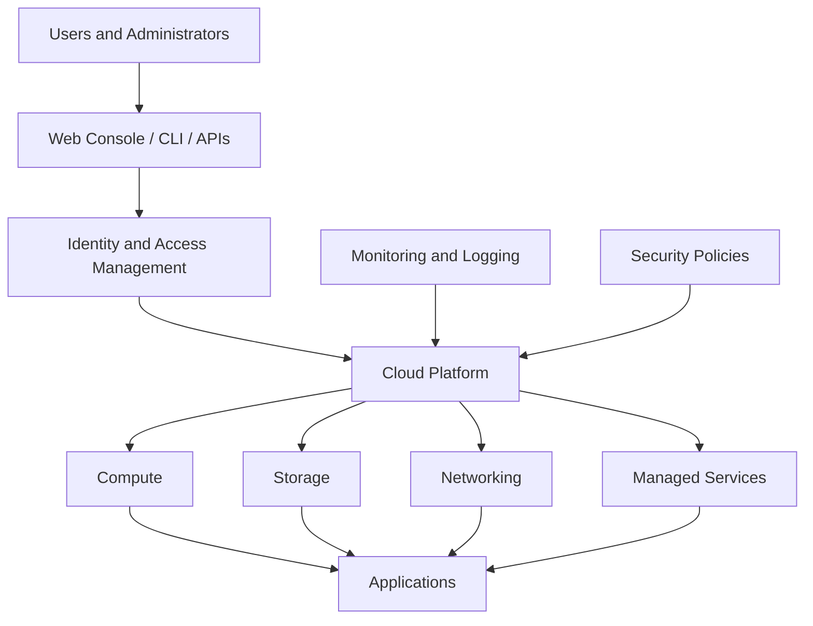
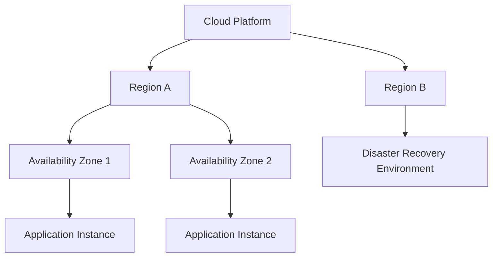
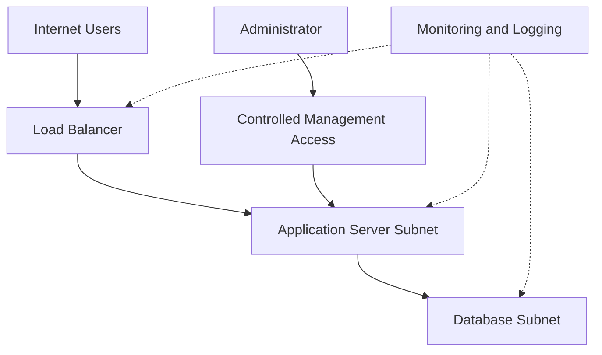
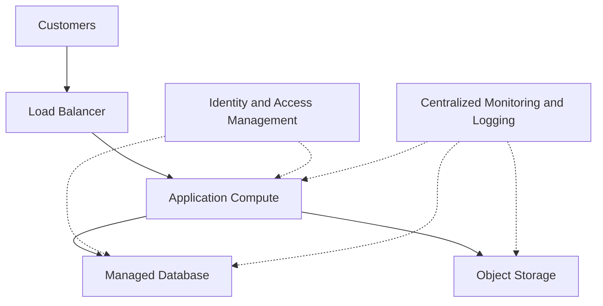

# ☁️ Understanding Major Cloud Platforms

> Major cloud platforms provide computing, storage, networking, databases, security, and other IT services over the internet. They allow organizations to build and operate applications without purchasing and managing every piece of physical infrastructure themselves.

## 1. 🌐 Cloud Ecosystem Overview

### 🧠 What Is a Cloud Ecosystem?

A **cloud ecosystem** is the collection of cloud services, technologies, tools, providers, and management systems that work together to support applications and IT infrastructure.

Imagine a company building an online shopping application. It needs:

* **Compute:** To execute the application's code.
* **Storage:** To store product images, documents, and backups.
* **Networking:** To connect users, application servers, and databases.
* **Databases:** To store customer information and orders.
* **Security:** To control access and protect sensitive information.
* **Monitoring:** To detect errors, suspicious activity, and performance problems.

A cloud platform provides services that can fulfill these requirements within a connected environment.

### 🏢 The Three Major Cloud Platforms

The three major cloud providers are:

| Platform               | Provider  | Commonly Used Services                                                                     | Important Strength                                                       |
| ---------------------- | --------- | ------------------------------------------------------------------------------------------ | ------------------------------------------------------------------------ |
| **AWS**                | Amazon    | EC2, S3, VPC, RDS, Lambda                                                                  | Broad service ecosystem and extensive infrastructure options             |
| **Microsoft Azure**    | Microsoft | Azure Virtual Machines, Blob Storage, Virtual Network, Azure SQL Database, Azure Functions | Integration with Microsoft enterprise environments                       |
| **Google Cloud (GCP)** | Google    | Compute Engine, Cloud Storage, VPC, Cloud SQL, Cloud Run                                   | Strong data analytics, managed infrastructure, and cloud-native services |

Official documentation:

* AWS: [https://docs.aws.amazon.com/](https://docs.aws.amazon.com/)
* Microsoft Azure: [https://learn.microsoft.com/azure/](https://learn.microsoft.com/azure/)
* Google Cloud: [https://cloud.google.com/docs](https://cloud.google.com/docs)

**Important:** These providers offer overlapping capabilities. No single provider is automatically best for every workload. The right choice depends on technical requirements, cost, existing infrastructure, skills, compliance, and service availability.

### ⚙️ How a Cloud Platform Works

When you create a virtual machine in a cloud platform, several components work together:

1. You use a web console, command-line interface (CLI), or API to request a virtual machine.
2. The cloud management system processes the request and applies relevant permissions and policies.
3. The provider allocates computing resources from its infrastructure.
4. You configure the operating system, applications, networking, and security controls that you are responsible for.
5. You monitor the machine, manage access, and pay according to the applicable pricing model.

The cloud provider manages the underlying physical infrastructure, while your responsibilities depend on the selected service.

### 🏗️ Cloud Ecosystem Architecture

This is a conceptual architecture. Actual cloud platforms implement these capabilities through different services and configurations.

### 🔑 Important Cloud Terminology

| Term              | Meaning                                                                                                                   |
| ----------------- | ------------------------------------------------------------------------------------------------------------------------- |
| Region            | A geographic area containing cloud infrastructure.                                                                        |
| Availability Zone | An isolated infrastructure location within a region, designed to help improve resilience.                                 |
| Resource          | An individual cloud component, such as a virtual machine, storage bucket, or database.                                    |
| Resource Group    | A logical grouping of resources, particularly used in Azure.                                                              |
| Project           | A resource and management boundary used in Google Cloud.                                                                  |
| Account           | A cloud identity or administrative boundary whose precise meaning varies by provider.                                     |
| API               | An interface that allows software to interact with cloud services.                                                        |
| CLI               | A command-line tool for managing cloud resources.                                                                         |
| IAM               | Identity and Access Management; controls who can access which resources and what actions they can perform.                |
| Multi-cloud       | Using services from multiple cloud providers.                                                                             |
| Cloud-native      | Designing applications to take advantage of cloud capabilities such as automation, managed services, and elastic scaling. |

### 🌍 Regions and Availability Zones

Cloud resources are not all located in one physical building.

Providers distribute infrastructure across geographic regions and isolated locations within those regions.

For example, an organization might run application instances in two availability zones and maintain a recovery environment in another region.

This can improve resilience, but it requires suitable architecture, data replication, network configuration, and recovery testing.

**Cybersecurity relevance:** Region selection can affect data residency, compliance, latency, disaster recovery, and the consequences of a regional outage.

---

## 2. 🖥️ Cloud Compute Services

### What Is Cloud Compute?

**Compute services provide the processing resources required to run applications, execute code, and perform calculations.**

They include virtual machines, containers, serverless computing, and managed application platforms.

Without compute services, stored code cannot execute as an application.

### A. Virtual Machines (VMs)

A virtual machine is a software-based computer that runs its own operating system on virtualized hardware.

Cloud providers allow users to create VMs without purchasing physical servers.

| Provider     | Compute Service        |
| ------------ | ---------------------- |
| AWS          | Amazon EC2             |
| Azure        | Azure Virtual Machines |
| Google Cloud | Compute Engine         |

**How it works:**

1. Select a machine configuration, including CPU, memory, and architecture.
2. Choose an operating system image.
3. Configure networking, authentication, and access permissions.
4. Launch the virtual machine.
5. Install and operate the software for which you are responsible.

**Cybersecurity example:** A security analyst creates a Linux VM to run log-analysis tools or conduct authorized security testing in an isolated lab.

**Advantages**

* Strong control over the guest operating system.
* Suitable for custom software and specialized workloads.
* Supports a wide variety of operating systems and configurations.

**Limitations**

* Requires patching and system administration.
* Incorrect firewall rules can expose services.
* Idle or oversized machines can waste money.

### B. Containers

A container packages an application and its dependencies into a portable unit.

Containers generally share the host operating system's kernel rather than each running a separate guest operating system like a typical VM.

| Technology                     | Purpose                                     |
| ------------------------------ | ------------------------------------------- |
| Docker                         | Builds and runs containers.                 |
| Kubernetes                     | Orchestrates containers across a cluster.   |
| Amazon ECS                     | Manages containerized applications on AWS.  |
| Amazon EKS                     | Managed Kubernetes service on AWS.          |
| Azure Kubernetes Service (AKS) | Managed Kubernetes service on Azure.        |
| Google Kubernetes Engine (GKE) | Managed Kubernetes service on Google Cloud. |

**Example:** A company packages a web application into a container so it can run consistently in development, testing, and production.

**Security considerations:**

* Use trusted container images.
* Scan images for known vulnerabilities.
* Avoid running containers with unnecessary privileges.
* Protect secrets and container registries.
* Patch the host operating system and relevant container components.

### C. Serverless Computing

Serverless computing allows developers to run code without directly managing the underlying server infrastructure.

**Serverless does not mean servers do not exist.** It means the provider manages much of the server provisioning and operational work.

| Provider     | Serverless Compute Service        |
| ------------ | --------------------------------- |
| AWS          | AWS Lambda                        |
| Azure        | Azure Functions                   |
| Google Cloud | Cloud Run and Cloud Run functions |

**Example:** An application automatically executes a function when a file is uploaded to cloud storage.

A possible workflow is:

1. A user uploads a file.
2. A storage event triggers a function.
3. The function validates the file.
4. The application stores processing results.
5. Logs and alerts record relevant activity.

**Advantages**

* Less server administration.
* Can scale automatically according to service capabilities and configuration.
* Suitable for event-driven tasks and short-running workloads.

**Limitations**

* Execution limits and pricing vary by service.
* Applications may depend on provider-specific features.
* Permissions and event triggers must be configured securely.

### 📊 Compute Service Comparison

| Feature                   | Virtual Machines                                 | Containers                                 | Serverless Functions                              |
| ------------------------- | ------------------------------------------------ | ------------------------------------------ | ------------------------------------------------- |
| Basic unit                | Virtual computer                                 | Application container                      | Function or event-driven execution                |
| Operating system control  | High over guest OS                               | Depends on container environment           | Usually limited                                   |
| Infrastructure management | More customer responsibility                     | Varies by deployment                       | Mostly provider-managed                           |
| Portability               | Depends on configuration                         | Often good with compatible runtimes        | Depends on runtime and provider integrations      |
| Typical use               | Full application servers and custom environments | Microservices and packaged applications    | Event processing and automated tasks              |
| Main security concern     | OS hardening and exposed services                | Image, runtime, and orchestration security | Permissions, event triggers, and application code |

### 🛡️ Compute from a Cybersecurity Perspective

An attacker who compromises a cloud VM may attempt to:

* Steal credentials or application secrets.
* Access other systems reachable from the machine.
* Exploit unpatched software.
* Abuse excessive cloud permissions.
* Install malware or use the machine for unauthorized activity.

Defenders should apply least privilege, restrict network access, patch systems, monitor activity, and avoid storing long-lived credentials in application code.

---

## 3. 💾 Cloud Storage Services

### What Is Cloud Storage?

Cloud storage provides ways to store and retrieve data without directly managing the physical storage hardware.

Different storage services are designed for different kinds of data and access patterns.

The three foundational categories are **object storage, block storage, and file storage**.

### A. Object Storage

Object storage stores data as individual objects, usually consisting of:

* The data itself.
* Metadata describing the object.
* A unique identifier or key.

Objects are organized within a storage service's logical structure, often using buckets or containers.

| Provider     | Object Storage Service |
| ------------ | ---------------------- |
| AWS          | Amazon S3              |
| Azure        | Azure Blob Storage     |
| Google Cloud | Cloud Storage          |

**Common uses:**

* Images and videos.
* Application files.
* Logs and datasets.
* Backups and archives.
* Static website assets.

**Cybersecurity example:** A company stores application audit logs in object storage for later investigation.

**Security considerations:**

* Block unintended public access.
* Apply least-privilege permissions.
* Encrypt sensitive data appropriately.
* Enable suitable logging and monitoring.
* Use versioning or retention controls where needed.
* Protect backup data against unauthorized deletion.

### B. Block Storage

Block storage provides storage volumes that operating systems and applications can use like disks.

It is commonly attached to virtual machines and can host filesystems, databases, and application data.

| Provider     | Example Service               |
| ------------ | ----------------------------- |
| AWS          | Amazon EBS                    |
| Azure        | Azure Managed Disks           |
| Google Cloud | Persistent Disk and Hyperdisk |

**Example:** A Linux VM uses an attached block-storage volume for its operating system or application database files.

**Security considerations:**

* Restrict access to storage volumes.
* Encrypt volumes where appropriate.
* Secure snapshots and backups.
* Control who can create, copy, attach, or delete volumes.

### C. File Storage

File storage organizes data into files and directories, often supporting shared access over network protocols.

| Provider     | Example Service           |
| ------------ | ------------------------- |
| AWS          | Amazon EFS and Amazon FSx |
| Azure        | Azure Files               |
| Google Cloud | Filestore                 |

**Common uses:**

* Shared team directories.
* Application files requiring shared filesystem access.
* Workloads that depend on familiar filesystem operations.

**Security considerations:**

* Configure file and directory permissions.
* Restrict network access.
* Apply appropriate identity controls.
* Monitor sensitive file access.

### 📊 Object vs Block vs File Storage

| Feature           | Object Storage                                          | Block Storage                              | File Storage                                   |
| ----------------- | ------------------------------------------------------- | ------------------------------------------ | ---------------------------------------------- |
| Data organization | Objects with identifiers and metadata                   | Fixed-size blocks presented as volumes     | Files and directories                          |
| Typical access    | APIs or HTTP-based interfaces                           | Attached storage volumes and block devices | Filesystem and network file protocols          |
| Common uses       | Backups, media, logs, datasets                          | VM disks and database storage              | Shared directories and compatible applications |
| Typical strength  | Scalable storage for large amounts of unstructured data | Flexible disk-like storage                 | Familiar file-sharing model                    |
| Important concern | Public access and permission mistakes                   | Volume and snapshot protection             | File permissions and network exposure          |

### 🧠 Example: Choosing Storage

A security team needs to store:

* Large collections of archived logs.
* The operating system disk for a Linux VM.
* Files shared by several application servers.

Suitable starting choices would be:

1. **Archived logs:** Object storage.
2. **Linux VM operating system disk:** Block storage.
3. **Shared application directory:** File storage.

Actual choices depend on access patterns, performance requirements, cost, and application compatibility.

### 🔐 Storage Security Checklist

Before storing sensitive data in the cloud:

* [ ] Classify the data.
* [ ] Restrict access to authorized identities.
* [ ] Prevent unintended public exposure.
* [ ] Enable appropriate encryption.
* [ ] Configure logging and monitoring.
* [ ] Define retention and deletion policies.
* [ ] Protect backups and snapshots.
* [ ] Test restoration and recovery.

**Important:** Encryption does not fix excessive permissions. Encrypted data can still be exposed if an authorized identity or decryption key is compromised.

---

## 4. 🌐 Cloud Networking Services

### What Is Cloud Networking?

Cloud networking connects cloud resources to one another, to users, and to external networks.

It includes virtual networks, IP addressing, routing, firewalls, load balancing, DNS, and private connectivity.

These concepts build directly on traditional networking topics such as IP addresses, subnetting, routing, TCP/IP, and network security.

### A. Virtual Networks

A virtual network provides a logically isolated networking environment for cloud resources.

| Provider     | Virtual Network Service |
| ------------ | ----------------------- |
| AWS          | Amazon VPC              |
| Azure        | Azure Virtual Network   |
| Google Cloud | Google Cloud VPC        |

A virtual network can contain subnets, routes, and security controls.

**Example:** A company creates a virtual network for its application servers and database servers.

The database is placed in a subnet without direct public access, while a public-facing component accepts approved internet traffic.

### B. Subnets and Routing

A subnet is a subdivision of an IP address range within a network.

Routing determines where packets should be forwarded.

A cloud architecture may separate resources into different network segments to reduce unnecessary connectivity.

For example:

* A public-facing application component receives permitted external traffic.
* An internal application component communicates with the database.
* The database accepts connections only from authorized application components.

**Cybersecurity benefit:** Network segmentation limits unnecessary communication and can reduce the impact of a compromised resource.

### C. Firewalls and Network Security Rules

Cloud networking services provide controls for allowing or denying network traffic.

Examples include:

* AWS security groups and network ACLs.
* Azure network security groups.
* Google Cloud VPC firewall rules.

The exact behavior and scope differ by provider.

A secure configuration should permit only required traffic.

For example, a web server may need inbound HTTPS access, while SSH administration should be restricted to approved sources or accessed through a controlled management path.

**Warning:** Opening management ports to the entire internet increases exposure and should be avoided unless there is a specific, justified, temporary requirement with appropriate safeguards.

### D. Load Balancers

A load balancer distributes incoming requests across multiple application instances.

**Benefits:**

* Helps distribute traffic.
* Can improve availability when combined with healthy instances.
* Can support scaling and controlled traffic distribution.

**Security considerations:**

* Configure TLS appropriately.
* Restrict direct access to backend instances when possible.
* Monitor unusual traffic patterns.
* Ensure health checks do not expose sensitive information.

### E. DNS and Private Connectivity

**DNS** translates domain names into information used to locate network services.

Cloud providers offer DNS services that can direct users to applications and support private naming within network environments.

Private connectivity options may allow organizations to connect on-premises infrastructure with cloud networks through VPNs, dedicated connections, or other provider-specific solutions.

**Security considerations:**

* Restrict administrative interfaces.
* Protect DNS and routing configurations.
* Monitor unexpected network changes.
* Use strong authentication for network-management access.

### 🏗️ Example: A Secure Cloud Network

In this simplified design:

* The load balancer receives approved external traffic.
* Application servers handle application logic.
* The database is separated from direct internet access.
* Administrative access uses a controlled path.
* Monitoring collects relevant operational and security events.

This is a conceptual example, not a complete production architecture. Real systems also need appropriate routing, identity controls, encryption, availability design, and provider-specific security configuration.

### 🛡️ Cloud Networking Security Principles

1. **Least privilege:** Allow only the network connections required.
2. **Segmentation:** Separate resources with different exposure or sensitivity.
3. **Private by default:** Avoid public access unless it is needed.
4. **Strong administration controls:** Restrict management access.
5. **Monitoring:** Log and investigate relevant network events.
6. **Defense in depth:** Combine network controls with identity, host, application, and data security.

---

## 5. ⚙️ Managed Cloud Services

### What Are Managed Services?

A managed cloud service is a service for which the provider operates and maintains significant parts of the underlying technology.

The customer can use the service without managing every underlying component directly.

Managed services exist across databases, compute, storage, networking, security, monitoring, and other areas.

**Key distinction:** Managed services reduce operational responsibility; they do not eliminate the customer's security responsibilities.

### A. Managed Databases

A managed database service handles many operational tasks, such as database provisioning, maintenance, and supported backup or recovery features.

Examples:

| Provider     | Managed Database Services                            |
| ------------ | ---------------------------------------------------- |
| AWS          | Amazon RDS and Amazon Aurora                         |
| Azure        | Azure SQL Database and Azure Database for PostgreSQL |
| Google Cloud | Cloud SQL and AlloyDB                                |

**Example:** A company uses a managed relational database to store customer orders.

The provider manages much of the database infrastructure, while the customer remains responsible for matters such as access permissions, data handling, application security, and configuration choices available to them.

**Advantages**

* Reduced database infrastructure administration.
* Simplified provisioning and maintenance.
* Available backup, monitoring, and resilience features, depending on the service.

**Limitations**

* Less control over some database settings and infrastructure.
* Service-specific restrictions.
* Costs and migration complexity may increase with particular designs.

### B. Managed Application Platforms

Managed application platforms provide an environment for deploying code without directly administering every underlying server.

Examples include Azure App Service and Google Cloud Run.

They can help teams focus on application development rather than infrastructure maintenance.

However, application vulnerabilities remain possible. Insecure authentication, injection flaws, unsafe dependencies, and exposed secrets must still be addressed.

### C. Managed Monitoring and Logging

Cloud monitoring services collect metrics, logs, and events to help teams understand system behavior.

Examples include:

* Amazon CloudWatch.
* Azure Monitor.
* Google Cloud Observability services.

Security teams use monitoring to investigate failed logins, unexpected resource creation, unusual API calls, and changes to access policies.

**Example:** An alert is generated when a privileged identity performs an unexpected administrative action.

Monitoring is most effective when events are collected consistently, alerts are tuned, and someone is responsible for investigating them.

### D. Managed Security Services

Cloud platforms offer security capabilities such as:

* Identity and access management.
* Threat detection.
* Security posture assessment.
* Key management.
* Vulnerability assessment.
* Audit logging and compliance support.

Examples include AWS IAM, Microsoft Entra ID integrations with Azure services, and Google Cloud IAM.

These products do not all serve the same purpose, and their capabilities vary.

**Important:** Enabling a security product does not guarantee protection. Teams must configure it appropriately, interpret its findings, and respond to alerts.

### 📊 Self-Managed vs Managed Services

| Responsibility            | Self-Managed Service                                     | Managed Cloud Service                                                            |
| ------------------------- | -------------------------------------------------------- | -------------------------------------------------------------------------------- |
| Underlying infrastructure | More customer responsibility                             | Provider manages much of it                                                      |
| Operating system          | Customer typically manages it                            | Often managed by provider, depending on service                                  |
| Patching                  | Customer handles relevant components                     | Provider handles covered components; customer handles remaining responsibilities |
| Application security      | Customer responsibility                                  | Customer responsibility for its applications                                     |
| Data access               | Customer responsibility                                  | Customer responsibility                                                          |
| Configuration             | Customer responsibility for customer-controlled settings | Customer remains responsible for settings within its control                     |
| Operational effort        | Usually higher                                           | Often lower                                                                      |

### 🧠 Example: A Database on a VM vs a Managed Database

**Option 1: Database installed on a virtual machine**

The organization is generally responsible for:

* Operating-system updates.
* Database installation and patching.
* Database configuration.
* Backup configuration and testing.
* Monitoring and access control.
* Recovery planning.

**Option 2: Managed database service**

The provider handles many underlying infrastructure and database-management tasks, depending on the service.

The organization still needs to:

* Configure identities and database permissions.
* Protect sensitive data.
* Secure application connections.
* Review network exposure.
* Monitor relevant events.
* Understand backup and recovery capabilities.
* Test recovery procedures.

The managed option can reduce operational burden, but it does not automatically make the database secure.

---

## 6. 🔐 Putting It All Together: A Cloud Application

Imagine a company wants to deploy a secure online shopping application.

It could combine services like these:

| Requirement                 | AWS Example       | Azure Example          | Google Cloud Example       |
| --------------------------- | ----------------- | ---------------------- | -------------------------- |
| Virtual machines            | Amazon EC2        | Azure Virtual Machines | Compute Engine             |
| Object storage              | Amazon S3         | Azure Blob Storage     | Cloud Storage              |
| Virtual networking          | Amazon VPC        | Azure Virtual Network  | Google Cloud VPC           |
| Managed relational database | Amazon RDS        | Azure SQL Database     | Cloud SQL                  |
| Serverless compute          | AWS Lambda        | Azure Functions        | Cloud Run functions        |
| Monitoring                  | Amazon CloudWatch | Azure Monitor          | Google Cloud Observability |

These are representative options, not a requirement to use every service in one application.

### 🏗️ Example Architecture

### How the Components Work Together

1. Customers send requests to the application.
2. The load balancer distributes requests to application instances.
3. Application code reads or writes order data in the database.
4. Product images and other suitable files are stored in object storage.
5. Identity controls restrict who can manage resources and access data.
6. Monitoring collects relevant events and metrics for troubleshooting and security investigations.

### 🛡️ What Would a Cloud Security Engineer Check?

* Are administrative identities protected by MFA?
* Do workloads have only the permissions they need?
* Is the database protected from direct public access?
* Are storage permissions configured correctly?
* Are application secrets stored securely?
* Are systems and dependencies patched?
* Are logs available for security investigations?
* Are backups protected and restoration procedures tested?
* Are unexpected resource changes detected?
* Are costs and resource usage monitored?

---

## 7. 🧪 Practical Exercise — Explore a Cloud Platform

You do not need a paid account or a running cloud VM to begin learning the ecosystem. Start by exploring the provider's official documentation and service descriptions.

Choose AWS, Azure, or Google Cloud and complete the following research task.

### Task

Identify the services that would satisfy these requirements:

1. Run a Linux virtual machine.
2. Store application log files.
3. Create an isolated virtual network.
4. Store relational application data in a managed database.
5. Collect system metrics and logs.
6. Control which identities can access resources.

Record your findings:

| Requirement | Service Name | Purpose | One Security Control |
| ----------- | ------------ | ------- | -------------------- |
| Compute     | ?            | ?       | ?                    |
| Storage     | ?            | ?       | ?                    |
| Networking  | ?            | ?       | ?                    |
| Database    | ?            | ?       | ?                    |
| Monitoring  | ?            | ?       | ?                    |
| Identity    | ?            | ?       | ?                    |

🔍 Reveal an example answer using AWS

| Requirement | AWS Service       | Purpose                           | Example Security Control                            |
| ----------- | ----------------- | --------------------------------- | --------------------------------------------------- |
| Compute     | Amazon EC2        | Run virtual machines              | Restrict inbound traffic using security groups      |
| Storage     | Amazon S3         | Store logs and files              | Block unintended public access                      |
| Networking  | Amazon VPC        | Create a virtual network          | Segment resources and control routes                |
| Database    | Amazon RDS        | Run a managed relational database | Restrict network access and database permissions    |
| Monitoring  | Amazon CloudWatch | Collect metrics and logs          | Configure relevant alerts and log retention         |
| Identity    | AWS IAM           | Manage identities and permissions | Apply least privilege and protect privileged access |

Service selection and configuration should be verified against current provider documentation before implementation.

**Safety note:** If you later create a real cloud account, review pricing, free-tier conditions, permissions, and resource cleanup before launching resources. Some services can incur charges even when you are only experimenting.

---

## ⚡ Quick Revision

* **Cloud ecosystem:** The connected services, technologies, tools, and management systems used to operate cloud workloads.
* **AWS, Azure, and Google Cloud:** Three major providers offering overlapping infrastructure and managed services.
* **Compute:** Runs code and applications through VMs, containers, serverless services, and other execution environments.
* **Object storage:** Stores objects and is commonly used for files, logs, backups, and datasets.
* **Block storage:** Provides disk-like volumes for operating systems and applications.
* **File storage:** Provides files and directories, often for shared access.
* **Cloud networking:** Connects and isolates resources through virtual networks, subnets, routes, firewalls, and load balancers.
* **Managed services:** Reduce the need to operate underlying infrastructure directly.
* **IAM:** Controls who can access cloud resources and what actions they can perform.
* **Monitoring:** Helps teams observe performance, investigate events, and detect suspicious activity.
* **Shared responsibility:** The provider manages some layers; the customer remains responsible for security tasks within their control.

## 🧠 Active Recall

Try answering these questions without looking back.

1. What is a cloud ecosystem?
2. What is the difference between a virtual machine and a container?
3. Why is serverless computing still dependent on servers?
4. When would object storage be more appropriate than block storage?
5. What is the purpose of a virtual network?
6. How does network segmentation improve security?
7. What does a managed database service reduce, and what responsibilities remain with the customer?
8. How can cloud monitoring help a SOC analyst?
9. What is the difference between a cloud region and an availability zone?
10. Why should cloud resource permissions follow the principle of least privilege?

## 🎯 Exam and Interview Questions

**1. Name the three major cloud platforms.**

Amazon Web Services (AWS), Microsoft Azure, and Google Cloud.

**2. Explain the difference between compute, storage, and networking.**

* Compute executes code and performs processing.
* Storage retains data.
* Networking connects systems and controls communication.

**3. Compare object storage and block storage.**

Object storage organizes data into objects accessed through storage interfaces, while block storage provides disk-like volumes that operating systems and applications can use.

**4. What is a managed cloud service?**

A service in which the provider operates significant portions of the underlying technology, reducing the customer's operational burden.

**5. Why can a managed service still be insecure?**

Customer-side weaknesses such as excessive permissions, exposed data, insecure application code, or inadequate monitoring can still create security risks.

**6. What is the role of IAM in cloud security?**

IAM defines and enforces which identities can access resources and which actions they can perform.

**7. Scenario: A cloud application is running, but its database is directly accessible from the internet. What would you investigate?**

Review the database's network exposure, firewall rules, routing, access controls, application connectivity, and logging. Restrict access to approved sources and investigate whether unauthorized access occurred.

## ⚠️ Common Mistakes

* Assuming all three major cloud providers use the same service names and configurations.
* Confusing object storage with a traditional filesystem.
* Believing containers provide exactly the same isolation as virtual machines.
* Assuming serverless means there are no servers.
* Treating managed services as completely maintenance-free.
* Exposing databases or administrative ports unnecessarily.
* Granting workloads broad permissions for convenience.
* Assuming monitoring automatically prevents attacks.
* Forgetting that cloud resources, data transfer, and managed services can generate costs.

## 🧩 Remember

**A cloud platform is an ecosystem of connected services.** Compute runs applications, storage retains data, networking connects and isolates resources, and managed services simplify operations. A cybersecurity professional must understand how these components interact because a weakness in one component can affect the security of the entire application.
