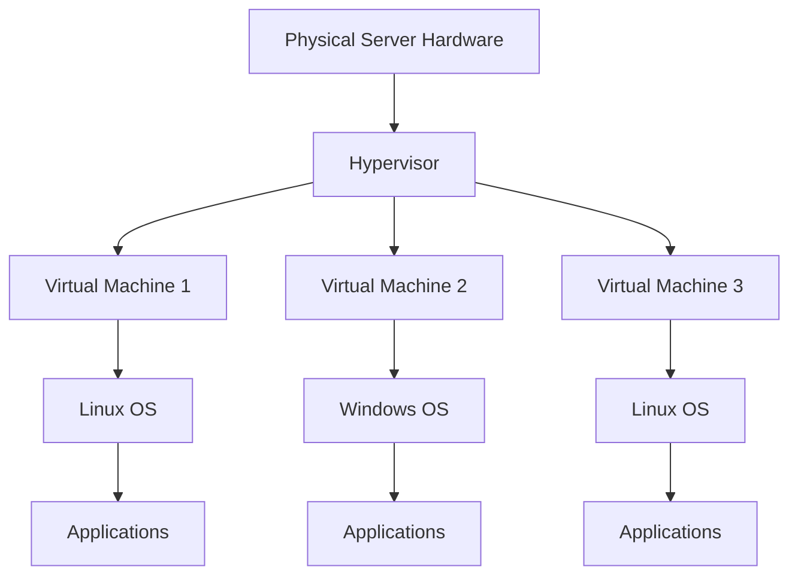
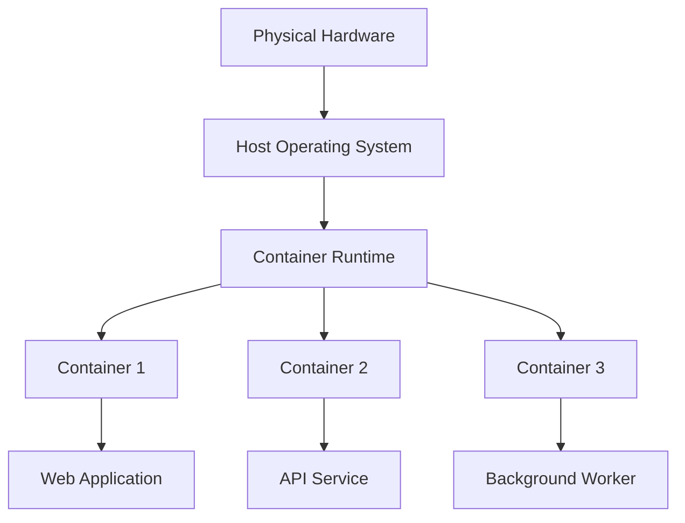
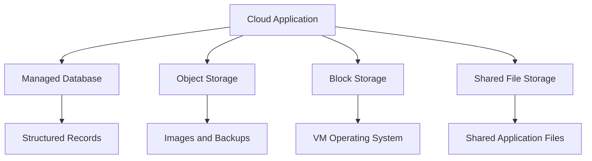
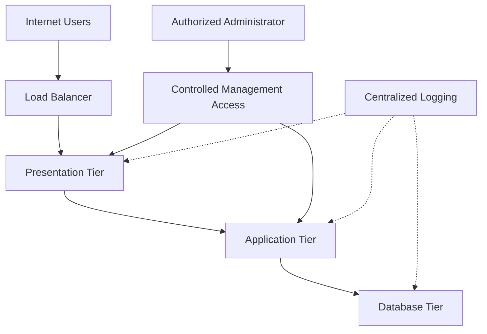
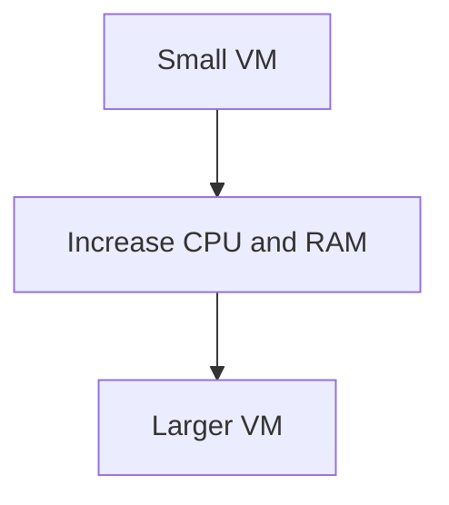
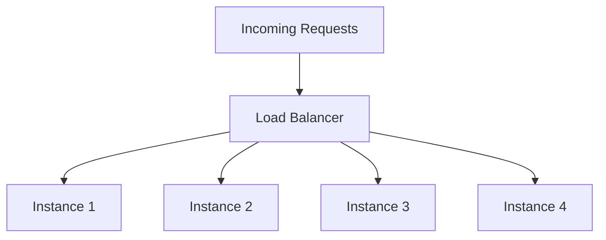
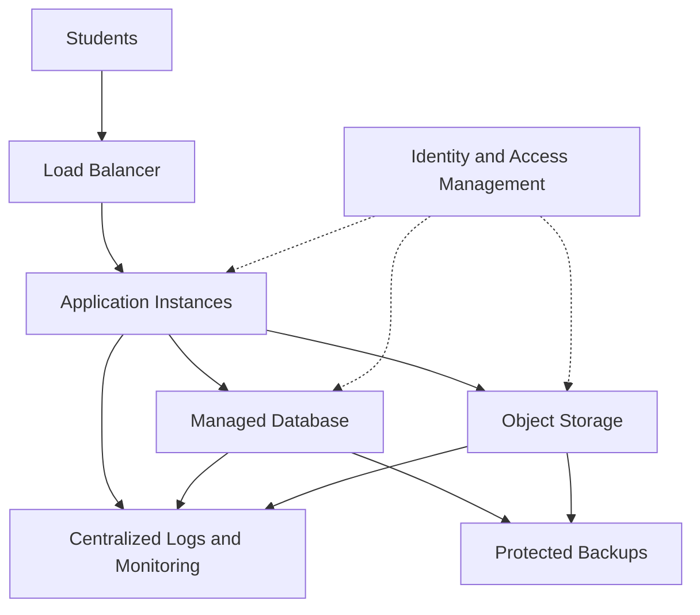

# 🏗️ Understanding Cloud Architecture

> **Cloud architecture** is the design and organization of cloud computing components—including compute resources, storage, networking, security controls, and applications—so they work together to deliver reliable, scalable, and secure services.

Cloud architecture explains how cloud resources are arranged, how they communicate, how applications process data, and how the entire system handles failures and changing workloads.

## 1. 🖥️ Virtual Machines (VMs)

### 🧠 What Is a Virtual Machine?

A **virtual machine (VM)** is a software-based computer that behaves like a physical computer. It has virtualized hardware resources, such as CPU, memory, storage, and network interfaces, and can run its own operating system.

For example, you can create a Linux VM in AWS, install security tools on it, and use it as a remote security laboratory without purchasing another physical computer.

### ⚙️ How Virtualization Works

Virtualization allows multiple virtual machines to share the resources of a physical server.

A software layer called a **hypervisor** creates and manages virtual machines.

There are two commonly described hypervisor types:

| Type                | Description                                        | Example                               |
| ------------------- | -------------------------------------------------- | ------------------------------------- |
| Type 1 (bare-metal) | Runs directly on the physical hardware.            | Microsoft Hyper-V, VMware ESXi        |
| Type 2 (hosted)     | Runs as an application on a host operating system. | Oracle VirtualBox, VMware Workstation |

Cloud providers commonly use virtualization technologies to allocate physical computing resources to customers. The exact implementation depends on the provider and service.

### 🏗️ Virtual Machine Architecture

Each VM receives allocated virtual resources and operates its own guest operating system.

### 🔍 Important VM Components

| Component                 | Purpose                                                                              |
| ------------------------- | ------------------------------------------------------------------------------------ |
| vCPU                      | Virtual processor resources allocated to the VM.                                     |
| RAM                       | Memory available to the operating system and applications.                           |
| Virtual disk              | Storage used for the operating system, applications, and data.                       |
| Virtual network interface | Connects the VM to a virtual network.                                                |
| Guest OS                  | The operating system running inside the VM.                                          |
| Hypervisor                | Creates and manages virtual machines.                                                |
| VM image                  | A template used to create a VM with a particular operating system and configuration. |

### ☁️ Virtual Machines in Cloud Computing

Major providers offer VM-based compute services:

| Provider        | Service                |
| --------------- | ---------------------- |
| AWS             | Amazon EC2             |
| Microsoft Azure | Azure Virtual Machines |
| Google Cloud    | Compute Engine         |

A typical workflow is:

1. Select a VM image.
2. Choose CPU, memory, and storage resources.
3. Configure network connectivity.
4. Define authentication and access controls.
5. Launch the VM.
6. Install and maintain applications.
7. Monitor performance, security, and costs.

### 🛡️ VM Security

Virtual machines are flexible, but they introduce security responsibilities.

**Common risks:**

* Unpatched operating systems.
* Exposed SSH or RDP ports.
* Weak authentication.
* Excessive cloud permissions.
* Insecure VM images.
* Unprotected snapshots and backups.

**Defensive practices:**

* Apply security updates regularly.
* Use SSH keys or other strong authentication mechanisms.
* Restrict administrative access to trusted sources.
* Apply least-privilege IAM policies.
* Use approved, maintained VM images.
* Monitor system logs and cloud activity.
* Protect snapshots and backups.

**Cybersecurity example:** If an attacker compromises an internet-facing Linux VM, they may attempt to steal application credentials or access other reachable resources. Network segmentation, restricted permissions, patching, and monitoring can help limit the damage.

---

## 2. 📦 Containers Awareness

### 🧠 What Is a Container?

A **container** packages an application and its required dependencies into an isolated execution environment.

Containers help applications run consistently across compatible environments without requiring a separate guest operating system for every container.

For example, a developer can package a Python web application and its dependencies into a container image, then run that application in development, testing, and production environments.

### ⚙️ How Containers Work

Containers commonly rely on operating-system features such as:

* **Namespaces:** Isolate views of resources such as processes and networking.
* **Control groups (cgroups):** Account for and limit resource consumption.
* **Container images:** Provide the application filesystem and required dependencies.
* **Container runtime:** Creates and runs containers from images.

On Linux, containers generally share the host kernel. This is one of the major differences between containers and conventional virtual machines.

### 🏗️ Container Architecture

The diagram is simplified. Production container environments may include orchestration platforms, registries, networking components, and additional security layers.

### 🆚 Virtual Machines vs Containers

| Feature                | Virtual Machine                                          | Container                                                            |
| ---------------------- | -------------------------------------------------------- | -------------------------------------------------------------------- |
| Operating system       | Runs a guest OS.                                         | Usually shares the host kernel.                                      |
| Isolation              | Virtualization-based isolation.                          | OS-level isolation, often with additional controls.                  |
| Resource overhead      | Generally higher because each VM runs a guest OS.        | Often lower for comparable workloads.                                |
| Startup time           | Often longer.                                            | Often shorter.                                                       |
| Portability            | Can move between compatible VM environments.             | Images can run across compatible container environments.             |
| Common use             | Full operating-system environments and legacy workloads. | Microservices, packaged applications, and deployment automation.     |
| Security consideration | Guest OS and hypervisor security.                        | Image, runtime, host kernel, privileges, and orchestration security. |

**Important:** Containers are not automatically more secure than VMs. Their isolation properties depend on configuration and implementation. A compromised container may threaten other workloads if the host or runtime is inadequately protected.

### ☸️ Container Orchestration

When an organization runs many containers across multiple servers, it may use a container orchestration system.

**Kubernetes** is a widely used container orchestration platform.

It helps manage tasks such as:

* Deploying containerized applications.
* Restarting failed containers.
* Distributing workloads.
* Scaling application replicas.
* Managing service discovery.
* Performing controlled application updates.

Cloud providers offer managed Kubernetes services, including Amazon EKS, Azure Kubernetes Service (AKS), and Google Kubernetes Engine (GKE).

### 🔐 Container Security Fundamentals

* Use trusted and maintained images.
* Scan images for known vulnerabilities.
* Avoid running containers as root unless necessary.
* Do not place passwords or API keys directly in images.
* Apply CPU and memory limits where appropriate.
* Restrict container network access.
* Patch the host operating system and runtime.
* Apply least privilege to container orchestration permissions.

**Remember:** A container is a way to package and run an application, while Kubernetes helps manage containers at scale. They are related technologies, but they are not the same thing.

---

## 3. 💾 Storage Architecture

### 🧠 What Is Storage Architecture?

**Storage architecture** describes how an application stores, organizes, accesses, protects, and recovers data.

Cloud applications rarely depend on a single storage type. They often use several services because different data has different requirements.

For example, an online shopping application may store:

* Product images in object storage.
* Database records in a managed relational database.
* VM operating-system files on block storage.
* Shared application files in file storage.
* Backups in a separate protected storage location.

### 🧱 The Three Main Storage Types

#### A. Object Storage

Stores data as objects with identifiers and metadata.

**Examples:**

* Amazon S3
* Azure Blob Storage
* Google Cloud Storage

**Suitable for:**

* Images and videos.
* Logs and datasets.
* Backups and archives.
* Static application assets.

Object storage is accessed through supported APIs or other service interfaces rather than behaving exactly like a conventional attached disk.

#### B. Block Storage

Provides storage volumes that an operating system can use like disks.

**Examples:**

* Amazon EBS
* Azure Managed Disks
* Google Cloud Persistent Disk

**Suitable for:**

* VM operating-system disks.
* Application data volumes.
* Workloads that require block-device access.

#### C. File Storage

Organizes data into files and directories, often supporting shared access.

**Examples:**

* Amazon EFS
* Azure Files
* Google Cloud Filestore

**Suitable for:**

* Shared directories.
* Applications that require filesystem semantics.
* Workloads needing shared file access.

### 📊 Storage Architecture Comparison

| Feature            | Object Storage                           | Block Storage                       | File Storage                       |
| ------------------ | ---------------------------------------- | ----------------------------------- | ---------------------------------- |
| Organization       | Objects and metadata                     | Storage blocks presented as volumes | Files and directories              |
| Access pattern     | Service APIs and object interfaces       | Block-device access                 | Filesystem operations              |
| Common use         | Logs, media, backups                     | VM disks, application volumes       | Shared directories                 |
| Main consideration | Access policies and lifecycle management | Volume performance and snapshots    | File permissions and shared access |

### 🏗️ Example Storage Architecture

Each storage component serves a different purpose.

### 🔄 Storage Durability, Availability, and Backup

These concepts are related but not interchangeable.

| Concept           | Meaning                                                                       |
| ----------------- | ----------------------------------------------------------------------------- |
| Durability        | The likelihood that stored data will not be lost or corrupted.                |
| Availability      | The ability to access a service or data when needed.                          |
| Backup            | A recoverable copy of data.                                                   |
| Replication       | Maintaining copies of data across storage locations or systems.               |
| Disaster recovery | Procedures and resources used to restore operations after a major disruption. |

A system can have highly durable storage but still experience an outage that prevents access to the data.

Likewise, replication alone may not protect against accidental deletion or malicious changes if those changes are replicated to every copy.

### 🛡️ Storage Security

Cloud storage should be designed around confidentiality, integrity, and availability.

**Important controls:**

* Enforce least-privilege access.
* Prevent unintended public exposure.
* Encrypt sensitive data where appropriate.
* Protect encryption keys.
* Enable versioning or immutable retention when suitable.
* Keep backups protected from ordinary administrative access.
* Test restoration procedures.
* Monitor access and configuration changes.

**Cybersecurity example:** If ransomware encrypts application files, protected backups can help restore the service. However, recovery depends on whether the backups are accessible, intact, and recent enough to meet the organization's recovery requirements.

---

## 4. 🌐 Network Architecture

### 🧠 What Is Cloud Network Architecture?

Cloud network architecture describes how cloud resources are connected, separated, and protected.

It includes virtual networks, subnets, routing, firewalls, load balancers, DNS, private connectivity, and network monitoring.

A well-designed network allows necessary communication while restricting unnecessary access.

### 🧩 Core Components

| Component                      | Purpose                                                                                                      |
| ------------------------------ | ------------------------------------------------------------------------------------------------------------ |
| Virtual network                | Provides a logically isolated network environment.                                                           |
| Subnet                         | Divides an IP address range into smaller network segments.                                                   |
| Route table                    | Determines how network traffic is forwarded.                                                                 |
| Internet gateway or equivalent | Provides a path between a virtual network and the internet when configured.                                  |
| NAT service                    | Allows supported outbound connectivity without directly assigning a public address to each private resource. |
| Firewall rules                 | Control permitted and denied network traffic.                                                                |
| Load balancer                  | Distributes requests across application instances.                                                           |
| VPN                            | Establishes an encrypted tunnel over another network.                                                        |
| DNS                            | Resolves domain names to relevant network information.                                                       |

Exact implementations and capabilities differ among providers.

### 🏗️ Three-Tier Network Architecture

A common design separates an application into three logical tiers.

1. **Presentation tier:** Handles incoming user requests.
2. **Application tier:** Executes application logic.
3. **Data tier:** Stores and processes persistent application data.

In a more detailed implementation, these tiers may occupy separate subnets with specific firewall and routing rules.

### 🔐 How Network Segmentation Improves Security

Imagine that a public-facing application server is compromised.

If the database accepts connections from any source, the attacker may be able to reach it directly.

If network rules allow database connections only from the application tier, the attacker's options may be reduced.

Segmentation helps limit the **blast radius** of a compromise, but it does not guarantee containment. An attacker may still exploit allowed connections, stolen credentials, or application vulnerabilities.

### 🌍 Public vs Private Resources

| Publicly Accessible Resource                                   | Private Resource                                                                               |
| -------------------------------------------------------------- | ---------------------------------------------------------------------------------------------- |
| Has a network path that permits access from external networks. | Is not directly reachable from the public internet through its intended network configuration. |
| May be required for public websites or APIs.                   | Commonly used for databases, internal services, and administrative components.                 |
| Needs carefully restricted exposure.                           | Still needs access controls and monitoring.                                                    |

**Important:** A resource having a public IP address does not necessarily mean every port is open. Effective exposure depends on routing, firewall rules, service configuration, and other controls.

Likewise, a resource without a public IP address may still be accessible through a compromised internal system or another permitted network path.

### 🛡️ Cloud Network Security Practices

* Expose only the services that must be publicly accessible.
* Restrict SSH and RDP administrative access.
* Separate public-facing components from sensitive internal resources.
* Allow only required communication between tiers.
* Use private connectivity where appropriate.
* Monitor network and configuration changes.
* Combine network restrictions with strong identity and application security.

**Professional insight:** A secure network is not defined simply by having a firewall. It is defined by whether communication paths are justified, restricted, monitored, and tested.

---

## 5. 📈 Scalability Concepts

### 🧠 What Is Scalability?

**Scalability** is the ability of a system to handle an increase in workload by adding or increasing resources.

For example, a website that handles 100 users may need more computing capacity when 10,000 users access it simultaneously.

Cloud platforms make it easier to provision resources, but the application architecture must be designed to use those resources effectively.

### A. Vertical Scaling (Scale Up)

Vertical scaling means increasing the capacity of an existing machine.

For example:

* Increasing a VM from 2 vCPUs to 8 vCPUs.
* Increasing memory from 4 GB to 16 GB.

**Advantages**

* Often simpler than redesigning an application.
* May work well for applications that require a single powerful machine.

**Limitations**

* The machine has an upper capacity limit.
* Resizing may require downtime or a restart, depending on the platform and operation.
* A single machine may remain a single point of failure.

### B. Horizontal Scaling (Scale Out)

Horizontal scaling means adding more instances to share the workload.

For example, instead of running one application server, an organization operates four instances behind a load balancer.

**Advantages**

* Can increase capacity by distributing work.
* Can improve resilience when combined with health checks and appropriate redundancy.
* Can support automated scaling.

**Limitations**

* Requires coordination between instances.
* Shared state and sessions may complicate application design.
* Additional instances increase operational complexity and may increase cost.

### 📊 Vertical vs Horizontal Scaling

| Feature        | Vertical Scaling                                        | Horizontal Scaling                                      |
| -------------- | ------------------------------------------------------- | ------------------------------------------------------- |
| Method         | Increase resources on an existing instance              | Add more instances                                      |
| Main change    | More CPU, RAM, or similar capacity                      | More application nodes                                  |
| Complexity     | Often simpler initially                                 | May require distributed-system design                   |
| Capacity limit | Limited by the largest supported instance               | Depends on architecture, quotas, and available capacity |
| Resilience     | Does not inherently eliminate a single point of failure | Can improve resilience when properly designed           |
| Suitable for   | Applications that scale well on a larger machine        | Workloads that can distribute work across instances     |

### C. Auto Scaling

Auto scaling automatically adjusts the number or capacity of resources according to defined conditions or schedules.

For example, an application may increase its instance count when CPU utilization remains high and reduce it when demand falls.

A typical auto-scaling workflow is:

1. Collect workload metrics.
2. Compare metrics against configured policies.
3. Add or remove instances within configured limits.
4. Register or remove instances from the relevant service.
5. Monitor the results.

Auto scaling must be configured with suitable thresholds, cooldown or stabilization behavior, capacity limits, and health checks.

### D. Load Balancing

A load balancer distributes requests across available application instances.

It works with scaling by directing traffic to the instances that are ready to serve requests.

Load balancing alone does not create more capacity. It distributes requests among the resources that already exist.

### E. Elasticity vs Scalability

These concepts are related but different.

* **Scalability:** The system's ability to handle growth by adding resources.
* **Elasticity:** The ability to adjust resources dynamically as workload demand changes.

A system may be scalable without automatically adding and removing resources. Elasticity usually involves adapting capacity as demand changes.

### F. High Availability vs Scalability

High availability focuses on keeping a service operational despite certain failures.

Scalability focuses on handling changing or increasing workloads.

| Concept           | Main Question                                                     |
| ----------------- | ----------------------------------------------------------------- |
| Scalability       | Can the system handle more work?                                  |
| Elasticity        | Can capacity adjust as demand changes?                            |
| High availability | Can the service continue operating when components fail?          |
| Fault tolerance   | Can the system continue functioning despite specified faults?     |
| Disaster recovery | Can the system and its data be restored after a major disruption? |

A well-designed system may use all these concepts, but none automatically guarantees the others.

### 🛡️ Security Implications of Scaling

Scaling introduces security and operational considerations.

**1. Identity and permissions**

New instances should receive only the permissions they need. Avoid giving every instance broad administrative access.

**2. Configuration consistency**

New instances should be created from maintained images or repeatable deployment configurations.

**3. Monitoring**

Logs and security events from newly created instances should be collected consistently.

**4. Resource abuse**

Unexpected scaling can cause high costs. Attackers may also attempt to abuse exposed services or compromised credentials to create resources.

**5. Capacity limits**

Scaling policies should use appropriate limits, quotas, and alerts.

**6. Availability**

Scaling cannot always solve bottlenecks in databases, external APIs, network capacity, or application logic.

**Professional insight:** Auto scaling can add more application servers, but if all those servers depend on one overloaded database, the application may still fail.

---

## 6. 🧩 Putting Cloud Architecture Together

Consider an online learning platform that stores videos, manages student accounts, and delivers lessons to users.

A possible architecture includes:

| Requirement           | Architectural Component     | Purpose                                 |
| --------------------- | --------------------------- | --------------------------------------- |
| Run the application   | VMs or containers           | Execute application code                |
| Store video files     | Object storage              | Store large media objects               |
| Store student records | Managed database            | Maintain structured data                |
| Connect components    | Virtual network             | Provide controlled communication        |
| Accept user traffic   | Load balancer               | Distribute requests                     |
| Increase capacity     | Auto scaling                | Adjust resources as demand changes      |
| Control access        | IAM                         | Restrict identities and permissions     |
| Detect problems       | Monitoring and logging      | Identify errors and suspicious activity |
| Recover from failures | Backups and recovery design | Restore data and services               |

### 🏗️ Complete Conceptual Architecture

This design illustrates the main relationships rather than a complete deployment. A production system would need detailed networking, authentication, encryption, availability, recovery, and cost-management decisions.

### 🔍 What Happens During a Traffic Spike?

Suppose a popular instructor announces a live course and thousands of students access the platform.

1. Incoming requests reach the load balancer.
2. Application instances process the requests.
3. Monitoring detects increased workload.
4. Auto scaling adds instances if the configured policies and available capacity allow it.
5. The load balancer directs requests to healthy instances.
6. The database and storage services handle their respective workloads.
7. Monitoring identifies bottlenecks and unusual activity.

If the database reaches its capacity limit, adding application instances may not solve the problem. Database capacity, query performance, connection pooling, caching, or architecture may also need attention.

---

## 🧪 Practical Thinking Exercise

A company hosts a web application on one Linux VM.

The application becomes slow during busy hours. The database runs on the same VM, SSH is accessible from the entire internet, and backups have never been tested.

Identify at least four architectural or security improvements.

🔍 Reveal the suggested solution

1. **Improve scaling:** Evaluate vertical scaling or move the application to multiple instances behind a load balancer.
2. **Separate components:** Consider separating the application and database into distinct resources or tiers.
3. **Restrict administration:** Limit SSH access to approved sources or a controlled management path and use strong authentication.
4. **Improve monitoring:** Collect application, system, and security logs and configure useful alerts.
5. **Protect backups:** Establish appropriate backups and test restoration regularly.
6. **Review capacity:** Determine whether CPU, memory, storage, database performance, or another bottleneck is causing the slowdown.
7. **Apply least privilege:** Restrict the application's permissions and the database's allowed connections.

The best solution depends on workload characteristics, budget, availability requirements, and the results of performance and security assessments.

---

## ⚡ Quick Revision

* **Cloud architecture:** The design of compute, storage, networking, security, and application components.
* **Virtual machine:** A virtualized computer that runs its own guest operating system.
* **Hypervisor:** Software that creates and manages virtual machines.
* **Container:** A packaged application environment that usually shares the host kernel.
* **Container orchestration:** Automated management of containerized applications across an environment.
* **Object storage:** Stores objects such as images, logs, and backups.
* **Block storage:** Provides disk-like storage volumes.
* **File storage:** Organizes data into files and directories.
* **Network segmentation:** Separates resources to restrict communication and reduce the potential impact of compromise.
* **Vertical scaling:** Increasing the capacity of an existing instance.
* **Horizontal scaling:** Adding more instances to distribute work.
* **Auto scaling:** Automatically adjusting resources based on configured policies.
* **Load balancing:** Distributing incoming requests across available resources.
* **Scalability:** The ability to handle more workload.
* **Elasticity:** The ability to adjust capacity as demand changes.
* **High availability:** Designing a service to remain operational despite certain failures.

## 🧠 Active Recall

1. What role does a hypervisor play in virtualization?
2. How do containers differ from virtual machines?
3. Why might a cloud application use object storage and block storage together?
4. How does network segmentation reduce security risk?
5. What is the difference between vertical and horizontal scaling?
6. Why does load balancing not automatically increase application capacity?
7. How are scalability and elasticity different?
8. Why can auto scaling fail to solve an overloaded database?
9. What security problems can arise when new instances are created automatically?
10. Why must organizations test their backups instead of simply checking whether backups exist?

## 🎯 Exam and Interview Questions

**1. Explain cloud architecture.**

Cloud architecture is the design and organization of computing, storage, networking, security, and application components that work together to deliver cloud services.

**2. Differentiate VMs and containers.**

VMs run guest operating systems on virtualized hardware, while containers typically share the host kernel and isolate application environments at the operating-system level.

**3. Explain the three major storage architectures.**

Object storage manages objects and metadata, block storage provides disk-like volumes, and file storage organizes data into files and directories.

**4. Why is network segmentation important?**

It limits unnecessary communication between resources and can reduce the potential impact of a compromised system.

**5. Explain vertical and horizontal scaling.**

Vertical scaling increases the capacity of an existing instance. Horizontal scaling adds instances to distribute workload.

**6. What is auto scaling?**

Auto scaling automatically adjusts computing resources according to configured metrics, policies, or schedules.

**7. Scenario: An application has four instances behind a load balancer, but it remains slow. What would you investigate?**

Investigate application performance, CPU and memory usage, database capacity, query performance, network latency, external dependencies, and whether the load balancer is distributing traffic as expected.

## ⚠️ Common Mistakes

* Assuming a VM is the same as a physical server.
* Assuming containers provide exactly the same isolation as VMs.
* Treating storage durability, availability, and backup as interchangeable.
* Assuming a private network eliminates the need for identity and access controls.
* Believing a load balancer creates additional computing resources.
* Assuming horizontal scaling automatically improves every application's performance.
* Confusing elasticity with scalability.
* Assuming auto scaling guarantees high availability.
* Forgetting to monitor newly created resources.
* Assuming backups are reliable without testing recovery.

## 🧩 Remember

**Good cloud architecture is about more than running applications in the cloud.** It combines compute, storage, networking, security, and scaling into a system that can operate reliably, handle changing workloads, protect data, and recover from failures.
