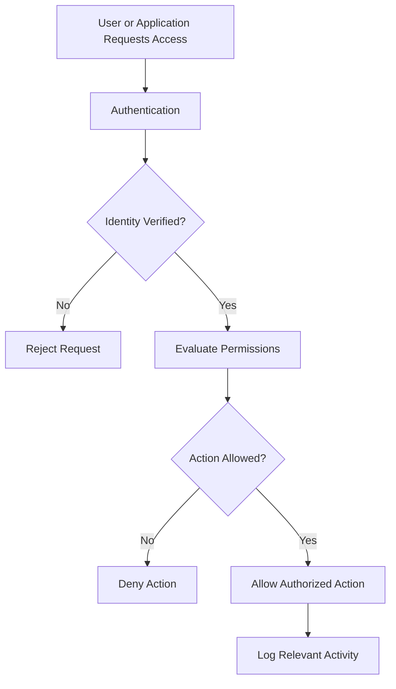
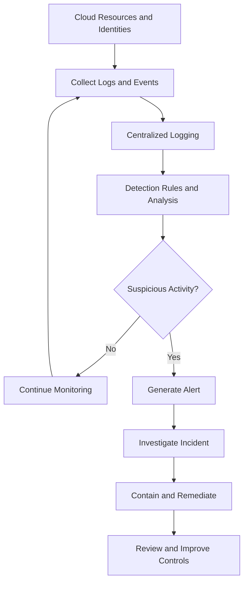

# 🔐 Cloud Security Fundamentals

> **Cloud security** is the collection of technologies, policies, and practices used to protect cloud infrastructure, applications, identities, networks, and data from unauthorized access, misuse, disruption, and cyberattacks.

Cloud computing changes how organizations build and operate systems, but it does not eliminate security risks. In many cases, cloud security depends heavily on how identities, permissions, services, and resources are configured.

For a cybersecurity professional, understanding cloud security is essential for protecting infrastructure, investigating suspicious activity, and preventing data breaches.

## 1. 🤝 Shared Responsibility Model

### 🧠 What Is the Shared Responsibility Model?

The **shared responsibility model** defines how security responsibilities are divided between a cloud service provider and its customer.

Think of renting an apartment. The building owner maintains the building's structure, but you are responsible for locking your apartment and protecting your belongings.

Cloud computing follows a similar principle: the provider secures the underlying cloud infrastructure, while the customer remains responsible for security tasks assigned to them.

The exact division depends on the cloud provider, service model, and configuration.

### 🏗️ How It Works

Cloud security responsibilities generally fall into two categories:

**1. Security of the cloud**

The provider protects the infrastructure that delivers cloud services.

Examples include:

* Physical data center security.
* Physical servers and networking equipment.
* Underlying virtualization infrastructure.
* Provider-managed infrastructure components.

**2. Security in the cloud**

The customer protects the resources, identities, data, and configurations within their responsibility.

Examples include:

* User accounts and permissions.
* Customer data and access policies.
* Application security.
* Network configuration.
* Operating-system security when the customer manages the OS.
* Security monitoring and incident response for customer workloads.

### 📊 Responsibility Across Cloud Service Models

| Responsibility                     | IaaS                                  | PaaS                                   | SaaS                                                                         |
| ---------------------------------- | ------------------------------------- | -------------------------------------- | ---------------------------------------------------------------------------- |
| Physical infrastructure            | Provider                              | Provider                               | Provider                                                                     |
| Virtualization infrastructure      | Provider                              | Provider                               | Provider                                                                     |
| Operating system                   | Customer typically manages it         | Provider typically manages it          | Provider manages it                                                          |
| Runtime and middleware             | Customer typically manages them       | Provider manages much of the platform  | Provider manages them                                                        |
| Application code                   | Customer                              | Customer for applications they develop | Provider manages the SaaS application                                        |
| Customer data                      | Customer responsibility               | Customer responsibility                | Customer responsibility                                                      |
| User accounts and permissions      | Customer configures relevant controls | Customer configures relevant controls  | Customer manages users and available access settings                         |
| Network and security configuration | Shared according to the service       | Shared according to the service        | Customer manages available settings; provider manages the underlying service |

This table is a general guide. Actual responsibilities vary by provider and service.

### 🔍 Example: A Cloud VM Is Compromised

Imagine a company launches a Linux virtual machine in a public cloud.

The administrator:

1. Opens SSH access to the entire internet.
2. Uses weak authentication.
3. Fails to install security updates.
4. Stores sensitive credentials on the machine.

An attacker compromises the VM.

The provider may have correctly secured its physical servers and virtualization infrastructure, while the customer introduced vulnerabilities through poor configuration and maintenance.

**Defensive measures:**

* Restrict SSH access.
* Use strong authentication.
* Patch the operating system.
* Apply least privilege.
* Monitor authentication and system activity.
* Store credentials securely.

### ⚠️ Why the Model Matters

A common misconception is:

> "My application is hosted by a major cloud provider, so the provider is responsible for its security."

This is incorrect.

A cloud provider may maintain the underlying infrastructure, but a customer can still expose confidential information by configuring a storage bucket incorrectly or granting excessive permissions.

**Remember:** Moving a workload to the cloud changes how security responsibilities are distributed; it does not remove the need for security.

---

## 2. 🪪 Identity Management

### 🧠 What Is Identity Management?

**Identity management** is the process of creating, maintaining, verifying, and managing identities that access systems and resources.

An identity can represent:

* A human user.
* An administrator.
* An application.
* A virtual machine.
* An automated script.
* A cloud service.

Cloud environments rely on identities to determine who or what is requesting access.

For example, when a Python script reads a file from cloud storage, the cloud platform needs a way to identify the script and determine whether it is authorized to read that file.

### 🔑 Important Identity Concepts

| Concept          | Meaning                                                                                          | Example                                                                         |
| ---------------- | ------------------------------------------------------------------------------------------------ | ------------------------------------------------------------------------------- |
| Identity         | Represents a user, application, or other entity                                                  | A cloud administrator account                                                   |
| Authentication   | Verifies an identity                                                                             | Signing in with credentials and MFA                                             |
| Authorization    | Determines permitted actions                                                                     | Allowing a user to read a storage object                                        |
| IAM              | Identity and Access Management                                                                   | Managing identities and permissions                                             |
| MFA              | Multi-Factor Authentication                                                                      | Password plus an authenticator-app code                                         |
| Service identity | Identity used by an application or workload                                                      | A cloud VM accessing a database                                                 |
| Federation       | Allows identities from one identity system to access another system through a trust relationship | Employees using their organization’s identity provider to access cloud services |

### 🔐 Authentication vs Authorization

These concepts are related but different.

**Authentication asks: "Who are you?"**

Examples:

* Entering a password.
* Using a security key.
* Approving an authentication request.

**Authorization asks: "What are you allowed to do?"**

Examples:

* Reading a file.
* Creating a virtual machine.
* Deleting a database.
* Changing an access policy.

### 📊 Authentication vs Authorization

| Feature        | Authentication                      | Authorization                                            |
| -------------- | ----------------------------------- | -------------------------------------------------------- |
| Purpose        | Verify identity                     | Determine permissions                                    |
| Main question  | Who are you?                        | What can you do?                                         |
| Usually occurs | Before access is granted            | When access is evaluated                                 |
| Example        | Validating an administrator's login | Checking whether the administrator can delete a resource |

Successful authentication does not automatically grant permission to perform every action.

### 🔄 Identity Verification Workflow

Actual cloud platforms may evaluate additional conditions, such as network restrictions, session properties, resource policies, and organizational security rules.

### 🛡️ Multi-Factor Authentication

MFA requires two or more authentication factors from different categories.

Common categories include:

1. **Something you know:** A password or PIN.
2. **Something you have:** A hardware security key or authenticator device.
3. **Something you are:** A biometric characteristic.

For example, an administrator might use a password and a hardware security key to sign in.

MFA reduces the risk associated with stolen passwords, although some methods are more resistant to phishing than others.

**Best practice:** Prefer phishing-resistant authentication, such as appropriately configured security keys or passkeys, where supported.

### 🤖 Human Identities vs Workload Identities

Cloud systems use identities for both people and software.

**Human identity example:** An administrator signs in to manage virtual machines.

**Workload identity example:** An application receives permission to write logs to a specific storage location.

Avoid placing long-lived access keys directly in source code.

Instead, use provider-supported workload identities, instance roles, managed identities, or short-lived credentials where appropriate.

### 🔐 Identity Security Best Practices

* Enable MFA for privileged and other sensitive accounts.
* Avoid shared administrator accounts.
* Use unique identities for individual users and workloads.
* Protect privileged accounts carefully.
* Remove inactive accounts and unnecessary credentials.
* Review identity activity regularly.
* Use short-lived credentials where possible.
* Protect account recovery mechanisms.
* Monitor unusual authentication attempts.

**Cybersecurity relevance:** Compromised cloud identities can allow attackers to access data, modify infrastructure, create resources, or disable security controls.

---

## 3. 🚦 Access Control

### 🧠 What Is Access Control?

**Access control** determines which identities can access which resources and what actions they can perform.

Identity management establishes and manages identities. Access control defines the permissions associated with those identities and evaluates access requests.

For example, an organization might allow a security analyst to view audit logs without allowing that analyst to delete the logs or change administrator permissions.

### 🔑 The Principle of Least Privilege

The **principle of least privilege** means granting an identity only the permissions necessary to perform its assigned tasks.

Suppose a Python application needs to upload reports to cloud storage.

It probably needs permission to write to a specific storage location. It does not automatically need permission to delete every storage bucket or administer the entire cloud account.

Least privilege reduces the damage that can occur if an account or application is compromised.

### 📊 Example of Least Privilege

| Identity             | Required Task               | Appropriate Access                                          |
| -------------------- | --------------------------- | ----------------------------------------------------------- |
| Security analyst     | Review audit logs           | Read relevant logs                                          |
| Developer            | Deploy application code     | Deployment permissions within an approved scope             |
| Backup service       | Create backup copies        | Required backup permissions for designated resources        |
| Application workload | Upload reports              | Write access to the required storage location               |
| Cloud administrator  | Manage cloud infrastructure | Privileged access limited to approved administrative duties |

Permissions should be scoped as narrowly as practical.

### 🧱 Common Access Control Models

#### A. Role-Based Access Control (RBAC)

RBAC assigns permissions through roles.

Users or workloads receive roles based on their responsibilities.

**Example:** A developer receives a deployment role rather than being granted unrelated billing and security-administration permissions.

**Advantages:**

* Easier to manage permissions across teams.
* Supports consistent job-based access.
* Reduces repetitive individual permission assignments.

**Limitation:** Poorly designed roles can grant excessive permissions.

#### B. Attribute-Based Access Control (ABAC)

ABAC evaluates attributes associated with the identity, resource, action, or request context.

**Example:** A policy allows access to a resource only when the user's department matches the resource's department and the requested action is permitted.

Attributes may include department, resource tags, environment, or other supported conditions.

**Advantages:**

* Supports context-sensitive access decisions.
* Can scale across large environments with consistent attributes.

**Limitations:**

* Policy logic can become difficult to understand.
* Incorrect attributes or rules may unintentionally grant or deny access.

#### C. Policy-Based Access Control

Cloud platforms often use policies to define allowed or denied actions.

A policy may specify:

* The identity or principal.
* The permitted actions.
* The resources affected.
* Conditions under which access is permitted or denied.

Policies are commonly used to implement RBAC, ABAC, and other access-control approaches.

### 📊 RBAC vs ABAC

| Feature    | RBAC                                         | ABAC                                                           |
| ---------- | -------------------------------------------- | -------------------------------------------------------------- |
| Main basis | Assigned role                                | Attributes and conditions                                      |
| Example    | Developer role permits approved deployments  | Access permitted when department and resource attributes match |
| Strength   | Simple and consistent for many job functions | Flexible, context-sensitive decisions                          |
| Challenge  | Roles may become broad or numerous           | Policies and attributes can become complex                     |

### 🔒 Access Control in Practice

Consider a cloud storage location containing confidential customer records.

A suitable design might:

1. Restrict access to authorized application identities.
2. Give analysts read-only access when that meets their needs.
3. Deny public access.
4. Require stronger authentication for administrative actions.
5. Log access and permission changes.
6. Review permissions regularly.

Cloud platforms may enforce access through several layers, such as identity policies, resource policies, network controls, and organizational restrictions.

The effective permission depends on the platform's policy evaluation rules.

### 🛡️ The Principle of Zero Trust

Zero Trust is a security approach based on the idea that access should not be granted merely because a user or system is inside a trusted network.

Instead, access decisions should consider identity, permissions, resource sensitivity, and relevant context.

Key principles include:

* Verify explicitly.
* Apply least privilege.
* Assume a breach is possible.
* Monitor access and activity.

**Important:** Zero Trust is not a single product. It is an architectural and operational approach.

### ⚠️ Common Access Control Failures

* Granting all users administrator permissions.
* Leaving unused identities active.
* Giving applications unnecessary access to storage or databases.
* Using shared credentials.
* Making confidential resources publicly accessible.
* Failing to review permission changes.
* Allowing compromised accounts to disable security monitoring.

**Remember:** A valid identity is not automatically a trustworthy identity, and an authenticated user should receive only the access required for the requested task.

---

## 4. 📊 Security Monitoring

### 🧠 What Is Cloud Security Monitoring?

Cloud security monitoring is the continuous collection and analysis of information about cloud identities, resources, configurations, applications, and network activity to detect suspicious behavior and investigate security incidents.

It helps answer questions such as:

* Who accessed a sensitive resource?
* Was an administrator account used unexpectedly?
* Did a storage resource become publicly accessible?
* Were unusual API calls made?
* Did a workload begin behaving abnormally?
* Were security policies changed?

Without monitoring, an organization may have difficulty detecting a compromise or determining what happened afterward.

### 🔍 What Should Be Monitored?

| Monitoring Area             | Examples of Events                                                  |
| --------------------------- | ------------------------------------------------------------------- |
| Identity and authentication | Failed logins, unusual sign-ins, privileged authentication          |
| Access control              | Permission changes, role assignments, policy modifications          |
| Cloud resources             | Unexpected VM creation, deletion, or configuration changes          |
| Storage                     | Unusual access patterns, public-access changes, unexpected deletion |
| Networking                  | Unexpected firewall changes or suspicious traffic patterns          |
| Applications                | Authentication failures, errors, unusual API requests               |
| Workloads                   | Unexpected processes, resource spikes, suspicious software behavior |
| Security configuration      | Disabled logging, weakened policies, changed monitoring settings    |

The appropriate events depend on the cloud service and the organization's threat model.

### 🧰 Cloud Monitoring Services

Examples of services offered by major providers include:

| Provider        | Monitoring and Logging                          | Security Monitoring Examples          |
| --------------- | ----------------------------------------------- | ------------------------------------- |
| AWS             | Amazon CloudWatch and AWS CloudTrail            | Amazon GuardDuty and AWS Security Hub |
| Microsoft Azure | Azure Monitor and Azure Activity Log            | Microsoft Defender for Cloud          |
| Google Cloud    | Google Cloud Observability and Cloud Audit Logs | Security Command Center               |

These services have different purposes and capabilities. Their availability and features may vary by account configuration, region, edition, and pricing plan.

### 📝 Logs vs Metrics vs Alerts

These three concepts serve different purposes.

**Logs:** Records of events that occurred.

Example: An administrator changed a storage access policy.

**Metrics:** Numerical measurements over time.

Example: A virtual machine's CPU utilization reached 95%.

**Alerts:** Notifications generated when configured conditions are met.

Example: An alert fires when privileged access occurs from an unexpected location or when a monitored security policy is changed.

### 📊 Comparison

| Feature  | Logs                       | Metrics                        | Alerts                                      |
| -------- | -------------------------- | ------------------------------ | ------------------------------------------- |
| Purpose  | Record events and activity | Measure system behavior        | Notify about conditions requiring attention |
| Example  | API call record            | CPU utilization                | Unexpected privileged activity              |
| Main use | Investigation and auditing | Performance and trend analysis | Detection and response                      |

### 🔄 Cloud Security Monitoring Workflow

This workflow represents a general detection and response process. Actual investigations may involve multiple tools and teams.

### 🚨 Example: Suspicious Cloud Activity

Imagine a cloud administrator's account is compromised.

An attacker uses the account to:

1. Create an unfamiliar virtual machine.
2. Modify access permissions.
3. Attempt to disable logging.
4. Access sensitive storage.

Monitoring can help identify unusual resource creation, privileged actions, policy changes, and suspicious data access.

A security analyst should:

* Validate the alerts.
* Review relevant identity and audit logs.
* Determine which resources and accounts are affected.
* Contain the compromised identity and unauthorized resources.
* Preserve relevant evidence.
* Restore appropriate security controls.
* Investigate potential data exposure.
* Document the incident and improve preventive controls.

Containment actions should follow the organization's incident-response procedures and account for operational impact.

### 🛡️ Monitoring Best Practices

* Enable relevant audit and activity logging.
* Centralize logs where appropriate.
* Restrict access to logging systems.
* Protect logs against unauthorized alteration or deletion.
* Configure meaningful alerts.
* Establish retention requirements.
* Synchronize timestamps where applicable.
* Investigate alerts according to severity.
* Test detection and incident-response procedures.
* Monitor attempts to disable security controls.

**Important:** Collecting logs is not enough. Security monitoring requires useful detections, appropriate alert handling, investigation, and response.

---

## 5. 🛡️ Cloud Security Best Practices

Cloud security works best when multiple controls reinforce one another.

### 1. Enforce Least Privilege

Grant only the permissions necessary for each user, application, or service.

Review access regularly and remove permissions that are no longer needed.

### 2. Protect Identities

* Enable MFA for privileged and sensitive accounts.
* Prefer phishing-resistant authentication where supported.
* Use separate administrative and ordinary user accounts where appropriate.
* Avoid sharing credentials.
* Use workload identities instead of embedded long-lived secrets.

### 3. Secure Network Access

* Restrict public exposure.
* Limit administrative ports.
* Separate application and data tiers.
* Allow only required communication.
* Review network rules periodically.

### 4. Protect Data

* Classify sensitive information.
* Apply appropriate encryption in transit and at rest.
* Restrict access to storage and databases.
* Protect encryption keys and secrets.
* Define retention and deletion policies.
* Secure backups and test restoration.

### 5. Maintain Systems and Applications

* Patch customer-managed operating systems and applications.
* Use trusted VM and container images.
* Scan dependencies for known vulnerabilities.
* Remove unnecessary services.
* Follow secure development practices.
* Review application permissions and secrets management.

### 6. Enable Monitoring and Logging

* Collect relevant audit logs.
* Monitor privileged activity.
* Alert on important configuration changes.
* Protect logs against tampering.
* Investigate suspicious events promptly.

### 7. Use Secure Configuration

* Apply approved security baselines.
* Avoid public access unless required.
* Review firewall rules and identity policies.
* Detect configuration drift.
* Automate safe, repeatable configurations where practical.

### 8. Prepare for Incidents

* Define incident-response procedures.
* Identify critical systems and data.
* Maintain protected backups.
* Test recovery plans.
* Know how to revoke credentials and contain compromised resources.
* Document lessons learned.

### 9. Manage Cost and Resource Abuse

Cloud security also includes protecting cloud accounts and resources against unauthorized or wasteful usage.

* Set budgets and usage alerts.
* Review unexpected resource creation.
* Apply quotas and appropriate limits.
* Monitor unusual usage patterns.
* Restrict who can provision expensive resources.

### 10. Review Compliance and Governance

Organizations should understand their legal, contractual, and regulatory requirements.

Depending on the environment, this may involve:

* Data residency requirements.
* Data retention rules.
* Audit evidence.
* Access reviews.
* Change management.
* Risk assessments.
* Documented security responsibilities.

Compliance does not automatically guarantee security, and security controls must reflect the actual risks.

### 🔐 Cloud Security Checklist

| Control           | Question                                                              |
| ----------------- | --------------------------------------------------------------------- |
| Identity          | Are privileged accounts protected with MFA?                           |
| Access            | Does each identity have only necessary permissions?                   |
| Network           | Are public services and management ports restricted?                  |
| Data              | Is sensitive data appropriately protected?                            |
| Configuration     | Are resources configured according to approved policies?              |
| Patching          | Are customer-managed systems maintained?                              |
| Monitoring        | Are relevant audit logs collected and reviewed?                       |
| Backups           | Are backups protected and restoration tested?                         |
| Incident response | Can compromised identities and resources be contained?                |
| Governance        | Are security responsibilities and compliance requirements understood? |

---

## 6. 🧪 Practical Scenario — Investigating a Cloud Security Incident

### Scenario

A company's cloud monitoring system reports three events:

1. A login to a privileged account from an unfamiliar location.
2. A change that allows public access to a storage resource.
3. A large increase in data downloads from that resource.

### Your Task

Think like a cloud security analyst.

1. Which event would you investigate first, and why?
2. What logs and records would you collect?
3. What immediate actions might contain the incident?
4. How would you determine whether confidential information was accessed?
5. Which preventive controls could reduce the chance of recurrence?

🔍 Reveal the suggested investigation approach

**1. Establish the timeline.**

Correlate authentication events, access-policy changes, storage access logs, and other relevant audit records.

**2. Validate the identity activity.**

Determine whether the privileged login was legitimate, whether MFA was used, and whether other unusual actions followed.

**3. Contain the threat.**

Follow incident-response procedures to secure or disable the compromised identity, revoke relevant sessions or credentials, and restore safe storage permissions. Consider operational impact before taking disruptive actions.

**4. Investigate possible data exposure.**

Review available access records, object identifiers, download volumes, affected resources, and relevant timestamps. Determine whether the evidence supports unauthorized access or data exfiltration.

**5. Preserve evidence.**

Protect relevant logs and records from deletion or alteration. Document investigative steps and findings.

**6. Improve security.**

Review MFA, privileged access, least-privilege permissions, public-access restrictions, alerting, and incident-response procedures.

**Important:** The alerts indicate a potentially serious incident, but they do not independently prove that a breach occurred. Conclusions must be based on evidence.

---

## ⚡ Quick Revision

* **Cloud security:** Protecting cloud infrastructure, identities, applications, data, and configurations.
* **Shared responsibility model:** Defines security responsibilities between the cloud provider and customer.
* **IAM:** Manages identities and permissions.
* **Authentication:** Verifies identity.
* **Authorization:** Determines which actions are allowed.
* **MFA:** Uses multiple authentication factors to strengthen identity verification.
* **Least privilege:** Grants only the permissions necessary for a task.
* **RBAC:** Assigns permissions through roles.
* **ABAC:** Uses attributes and conditions to make access decisions.
* **Zero Trust:** Requires appropriate verification and access decisions rather than relying on network location alone.
* **Security monitoring:** Collects and analyzes events to detect suspicious behavior.
* **Logs:** Record events.
* **Metrics:** Measure system behavior.
* **Alerts:** Notify teams about conditions that require attention.
* **Defense in depth:** Uses multiple complementary security controls.
* **Incident response:** Identifies, investigates, contains, and recovers from security incidents.

## 🧠 Active Recall

Try to answer these without looking back.

1. What is the difference between security of the cloud and security in the cloud?
2. How does the shared responsibility model differ between IaaS and SaaS?
3. Why is authentication different from authorization?
4. How does MFA help protect cloud accounts?
5. What is the principle of least privilege?
6. How do RBAC and ABAC differ?
7. Why does Zero Trust not rely solely on network location?
8. What is the difference between logs, metrics, and alerts?
9. Why should access to audit logs be restricted?
10. What steps should a security analyst take after detecting suspicious privileged activity?

## 🎯 Exam and Interview Questions

**1. Define cloud security.**

Cloud security is the set of technologies, controls, policies, and practices used to protect cloud-based infrastructure, applications, identities, and data.

**2. Explain the shared responsibility model.**

It divides security responsibilities between the cloud provider and customer. The provider protects the underlying infrastructure, while the customer remains responsible for security tasks assigned to them, such as managing identities, protecting data, and configuring customer-controlled resources.

**3. Differentiate authentication and authorization.**

Authentication verifies an identity, while authorization determines which actions that identity is permitted to perform.

**4. Why is least privilege important?**

It limits unnecessary access and can reduce the damage caused by compromised accounts or applications.

**5. What is the purpose of cloud security monitoring?**

It helps detect suspicious activity, investigate incidents, maintain audit records, and identify security problems.

**6. Scenario: An application has permission to administer the entire cloud account, but it only needs to upload reports. What is the problem?**

The application has excessive privileges. Its permissions should be restricted to the necessary upload operations and relevant storage resources.

**7. Scenario: A cloud provider offers encryption, but a storage resource is publicly accessible. Is encryption sufficient?**

No. Encryption is one protective control, but access restrictions are also necessary. Depending on how encryption keys and access permissions are configured, public exposure may still lead to unauthorized data disclosure.

## ⚠️ Common Mistakes

* Assuming the cloud provider is responsible for every security task.
* Confusing authentication with authorization.
* Giving applications administrator permissions for convenience.
* Treating MFA as a replacement for least privilege.
* Assuming a private network makes every resource trustworthy.
* Collecting logs without monitoring or investigating them.
* Believing that encryption alone prevents data exposure.
* Assuming security products work effectively without proper configuration.
* Failing to protect audit logs against tampering.
* Treating compliance as proof that an environment is secure.

## 🧩 Remember

**Cloud security depends on controlling access, protecting identities and data, monitoring activity, and clearly understanding shared responsibilities.** A secure cloud environment does not rely on a single tool—it uses multiple layers of preventive, detective, and responsive controls.
