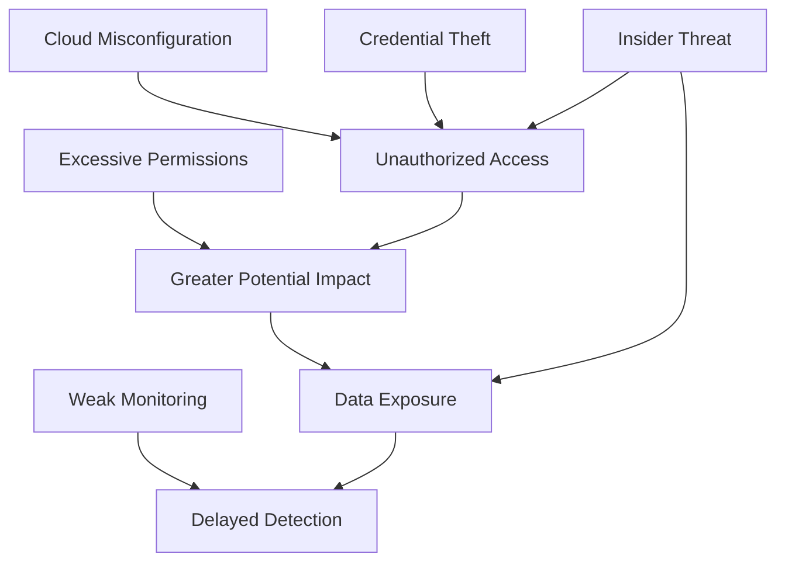

# ☁️ Understanding Cloud Threats

> **Cloud threats** are security risks that can compromise the confidentiality, integrity, or availability of cloud-based systems, applications, and data.

Cloud computing allows organizations to store data, run applications, and manage infrastructure over the internet. However, cloud environments introduce security challenges involving configurations, identities, permissions, data storage, and human behavior.

Understanding these threats helps cybersecurity professionals identify weaknesses, investigate suspicious activity, and implement effective security controls.

---

## 1. ⚙️ Cloud Misconfigurations

### What Is a Cloud Misconfiguration?

A **cloud misconfiguration** occurs when a cloud resource is configured incorrectly, leaving it exposed to unauthorized access, data leakage, or other security risks.

Cloud environments contain many configurable resources, including storage buckets, virtual machines, databases, firewalls, network rules, and identity policies.

A small configuration mistake can expose an entire system to the internet.

### Common Examples

| Misconfiguration                    | Security Risk                                              |
| ----------------------------------- | ---------------------------------------------------------- |
| Publicly accessible storage bucket  | Unauthorized users may access stored files                 |
| Database exposed to the internet    | Attackers may attempt to access or exploit the database    |
| Firewall allows all inbound traffic | Unnecessary network exposure                               |
| Logging disabled                    | Suspicious activity may go undetected                      |
| Default credentials left unchanged  | Attackers may gain access using known credentials          |
| Encryption disabled where required  | Data may lack appropriate protection at rest or in transit |

### How Does a Misconfiguration Lead to an Attack?

Consider a company storing customer information in a cloud storage bucket.

1. An administrator creates a storage bucket.
2. The bucket is accidentally configured for public access.
3. Sensitive files are uploaded.
4. An unauthorized person discovers the exposed files.
5. The information may be downloaded, copied, or published.

The attacker might not need to exploit a software vulnerability. The incorrect configuration itself creates the weakness.

### How to Prevent Cloud Misconfigurations

* Apply secure configuration baselines.
* Disable public access unless it is explicitly required.
* Restrict inbound network traffic to necessary sources and ports.
* Enable appropriate logging and monitoring.
* Review configurations regularly.
* Use Infrastructure as Code (IaC) with security checks.
* Use cloud security posture management (CSPM) tools where appropriate.
* Apply changes through controlled review and approval processes.

**Example:** Before deploying a cloud application, a security team scans its configuration files to identify publicly exposed databases and overly permissive firewall rules.

### Key Takeaway

> **A cloud resource can be vulnerable even when its software is fully patched.** Secure configuration is an essential part of cloud security.

---

## 2. 🔑 Credential Theft

### What Is Credential Theft?

**Credential theft** occurs when an attacker obtains authentication information that belongs to a legitimate user, administrator, application, or service.

Credentials may include:

* Usernames and passwords
* API keys
* Access tokens
* Session cookies
* SSH private keys
* Service account credentials
* Cloud access keys

Cloud credentials are particularly valuable because they may provide remote access to infrastructure, applications, storage, and sensitive information.

### How Are Cloud Credentials Stolen?

| Attack Method       | Explanation                                                                            |
| ------------------- | -------------------------------------------------------------------------------------- |
| Phishing            | A victim is tricked into revealing credentials through a fraudulent message or website |
| Password reuse      | Credentials exposed by one service are used to attempt access to another               |
| Malware             | Malicious software steals passwords, tokens, or keys                                   |
| Leaked secrets      | API keys or passwords are accidentally published in source code or repositories        |
| Token theft         | An attacker obtains a valid session or authentication token                            |
| Social engineering  | An attacker manipulates a person into revealing information or approving access        |
| Compromised devices | Credentials are stolen from an infected or poorly secured endpoint                     |

### How a Credential-Based Attack Works

Imagine a developer accidentally publishes a cloud access key in a public code repository.

1. The developer uploads code containing the access key.
2. An attacker discovers the exposed key.
3. The attacker tests whether the key is valid.
4. If the key is active, the attacker attempts to use its permissions.
5. Depending on those permissions, the attacker may access data, create resources, or perform other unauthorized actions.

The impact depends on the credential's privileges, validity, and the security controls surrounding it.

### Why Are Cloud Credentials So Valuable?

Cloud environments are accessible through remote management interfaces and APIs. A stolen credential may allow an attacker to interact with cloud resources without exploiting the underlying operating system.

For example, a compromised account with permission to read storage objects might expose sensitive documents. A compromised administrator account could have much broader access.

**Important distinction:**

* **Credential theft** means obtaining authentication information.
* **Account compromise** means gaining unauthorized control or access to an account.
* Credential theft can lead to account compromise, but additional security controls may prevent it.

### How to Prevent Credential Theft

* Enable multifactor authentication (MFA), especially for privileged accounts.
* Prefer phishing-resistant MFA for high-risk access.
* Use a password manager and unique passwords.
* Avoid embedding secrets in source code.
* Store secrets in a dedicated secrets-management service.
* Use short-lived credentials instead of long-lived access keys when possible.
* Rotate or revoke credentials when exposure is suspected.
* Monitor unusual login attempts and API activity.
* Apply endpoint security and phishing awareness training.

### What Should You Do If a Cloud Key Is Exposed?

1. Revoke or disable the exposed key immediately.
2. Create replacement credentials if needed.
3. Review cloud audit logs for unauthorized activity.
4. Identify resources or data accessed using the credential.
5. Remove the secret from the source of exposure and its history where practical.
6. Investigate how the key was exposed.
7. Improve secret-scanning and access-control processes.

**Remember:** Removing a leaked key from the latest version of a repository does not automatically make the exposed key safe. It must be revoked or otherwise invalidated.

---

## 3. 🛡️ Excessive Permissions

### What Are Excessive Permissions?

**Excessive permissions** occur when a user, application, service account, or other identity has more access rights than necessary to perform its intended tasks.

This violates the **Principle of Least Privilege**, which states that each identity should receive only the minimum permissions required for its responsibilities.

### Example

A developer needs to read files from a specific storage location.

However, the developer is granted administrator-level access to the entire cloud account.

The developer can perform the required task, but the additional privileges create unnecessary risk.

If the account is compromised, the attacker may inherit the same excessive permissions.

### Common Examples

| Excessive Permission                                      | Potential Impact                                   |
| --------------------------------------------------------- | -------------------------------------------------- |
| Read and write access when read-only access is sufficient | Unauthorized modification or deletion              |
| Administrator access for ordinary users                   | Broader control over cloud resources               |
| Access to all storage buckets instead of one              | Exposure of unrelated sensitive data               |
| Unrestricted permissions for an application               | Increased impact if the application is compromised |
| Unused permissions that remain active                     | Additional attack opportunities                    |
| Broad permissions across multiple projects                | Compromise may affect several environments         |

### How Excessive Permissions Increase Risk

A useful security concept is the **blast radius**: the amount of damage an attacker can cause after compromising an identity or system.

Consider two compromised accounts:

* **Account A:** Can read files from one designated storage bucket.
* **Account B:** Can administer storage, modify access policies, and delete resources across an entire cloud environment.

Account B presents a much larger potential blast radius.

Least privilege reduces the opportunities available to an attacker after an account or workload is compromised.

### How to Reduce Excessive Permissions

**1. Apply least privilege**

Grant only the permissions required for a specific job.

**2. Use role-based access control (RBAC)**

Assign permissions through roles associated with defined responsibilities.

**3. Review access regularly**

Remove unnecessary permissions when users change roles or applications no longer require access.

**4. Separate duties**

Avoid giving one identity unrestricted control over every stage of a sensitive process.

**5. Use temporary privileged access**

Grant elevated privileges only when needed and for a limited period.

**6. Monitor permission changes**

Alert on suspicious privilege escalation, unexpected role assignments, and changes to access policies.

### Least Privilege in Practice

Instead of granting an application full cloud administrator access:

* Create a dedicated workload identity.
* Allow it to read only the required data.
* Restrict access to the specific resource.
* Avoid permissions to modify identity policies.
* Monitor its activity.

### Key Takeaway

> **The more privileges an identity has, the greater the potential damage if that identity is compromised.**

---

## 4. 📂 Data Exposure

### What Is Cloud Data Exposure?

**Cloud data exposure** occurs when sensitive information becomes accessible to unauthorized people or systems.

It can result from misconfigurations, stolen credentials, excessive permissions, insecure application design, accidental sharing, or inadequate data protection.

Data exposure and data breaches are related but not identical:

* **Data exposure:** Data is accessible or insufficiently protected.
* **Data breach:** A security incident involving unauthorized access to, disclosure of, or acquisition of protected information.

An exposed resource may not have been accessed by an attacker, but it still represents a security risk.

### Types of Sensitive Cloud Data

* Personally identifiable information (PII)
* Customer records
* Financial information
* Authentication credentials
* API keys and secrets
* Business documents
* Intellectual property
* Backups and database exports
* Security logs containing sensitive details

### Common Causes of Data Exposure

| Cause                 | Example                                                             |
| --------------------- | ------------------------------------------------------------------- |
| Public storage        | Internal documents are accessible without authentication            |
| Weak access control   | Users can retrieve records they should not access                   |
| Credential compromise | An attacker uses a stolen account to download data                  |
| Insecure APIs         | An API returns records without properly checking authorization      |
| Unprotected backups   | Database exports are stored without appropriate access restrictions |
| Missing encryption    | Sensitive data lacks required encryption protections                |
| Accidental sharing    | An employee shares a confidential file with the wrong audience      |

### Data Exposure Scenario

A company stores customer records in a cloud database.

An application checks whether a user is logged in but does not verify whether that user is authorized to view a particular customer's record.

An attacker discovers that changing a record identifier in an API request reveals another customer's information.

This is an **authorization failure**, potentially associated with Broken Object Level Authorization (BOLA), a common API security issue.

The cloud provider may be operating its infrastructure securely, yet the company's application can still expose sensitive data.

### How to Protect Cloud Data

**1. Classify data**

Identify whether information is public, internal, confidential, or highly sensitive.

**2. Apply access controls**

Restrict data access to authorized identities and applications.

**3. Encrypt sensitive information**

Use appropriate encryption for data at rest and in transit. Protect encryption keys separately and control who can use them.

**4. Prevent accidental public access**

Use public-access restrictions and review resource-sharing settings.

**5. Validate authorization**

Ensure applications verify that each user is allowed to access the specific resource requested—not merely that the user is logged in.

**6. Monitor data access**

Investigate unusual downloads, large data transfers, unexpected access locations, and suspicious API activity.

**7. Minimize data retention**

Avoid storing sensitive information longer than necessary, subject to legal and business requirements.

**8. Protect backups**

Apply appropriate access restrictions, encryption, retention policies, and recovery testing.

### Encryption Does Not Solve Everything

Encryption is an important safeguard, but it does not prevent every form of data exposure.

For example, if an attacker compromises an authorized application or identity that can decrypt data, the attacker may be able to access the plaintext.

Effective protection therefore combines encryption with identity security, access control, monitoring, secure application design, and data governance.

### Key Takeaway

> **Protecting cloud data requires controlling who can access it, what they can do with it, and how it is stored, transmitted, and monitored.**

---

## 5. 👤 Insider Threats

### What Is an Insider Threat?

An **insider threat** is a security risk originating from someone who has legitimate access to an organization's systems, data, or facilities.

Insiders may include:

* Employees
* Contractors
* System administrators
* Developers
* Third-party support personnel
* Other trusted users with authorized access

An insider threat does not always involve a malicious person. It can result from intentional wrongdoing, negligence, or an account compromised by an external attacker.

### Types of Insider Threats

| Type                        | Description                                        | Example                                                                      |
| --------------------------- | -------------------------------------------------- | ---------------------------------------------------------------------------- |
| Malicious insider           | Intentionally abuses legitimate access             | An employee steals customer records before leaving the company               |
| Negligent insider           | Accidentally creates a security risk               | An employee shares a confidential file publicly                              |
| Compromised insider account | An attacker takes control of a legitimate identity | A phishing attack leads to unauthorized access through an employee's account |

### Why Are Insider Threats Difficult to Detect?

Insiders may already have legitimate access to sensitive resources. Their actions can resemble normal business activity, making malicious behavior difficult to distinguish from legitimate work.

For example, a database administrator may normally export data for maintenance. An unusually large export outside the person's normal work pattern could warrant investigation, but the activity alone does not prove malicious intent.

Security teams must consider context, authorization, business needs, and other evidence.

### Common Warning Signs

Possible indicators include:

* Access to resources unrelated to a user's role
* Unusual downloads or data transfers
* Privilege changes without an approved reason
* Access outside normal work patterns
* Attempts to disable logging or security controls
* Unusual access shortly before an account is deactivated

**Important:** These indicators are not proof of wrongdoing. They should be investigated carefully and consistently, with appropriate privacy safeguards.

### How to Reduce Insider Threats

* Apply least privilege and role-based access control.
* Separate sensitive duties between different identities.
* Review access when employees change roles or leave.
* Monitor privileged activity and sensitive data access.
* Protect audit logs from unauthorized modification.
* Require approval for high-risk operations.
* Establish clear data-handling policies.
* Provide security awareness training.
* Use a documented incident-response process.

### Example: A Malicious Insider

A cloud administrator has permission to access customer data.

The administrator attempts to copy a large dataset to an unauthorized destination.

A well-designed security program may detect the unusual transfer, generate an alert, preserve relevant audit logs, and initiate an investigation.

The response should follow established procedures rather than assuming guilt based on a single alert.

### Key Takeaway

> **Trust should be supported by verification, restricted permissions, and accountability—not by unrestricted access.**

---

## 6. 🔗 How Cloud Threats Are Connected

Cloud threats rarely occur in complete isolation. One weakness can enable or amplify another.

Consider this example:

1. A developer accidentally publishes a cloud access key.
2. An attacker obtains the credential.
3. The key has excessive permissions.
4. The attacker accesses a storage resource.
5. Sensitive customer data is exposed.
6. If monitoring is inadequate, the activity may remain undetected.

This chain combines **credential theft, excessive permissions, and data exposure**. A misconfiguration could make the impact worse, while an insider could create a similar risk intentionally or accidentally.

### Threat Relationship Diagram



This diagram illustrates possible relationships, not a sequence that occurs in every incident.

### Example of Layered Defense

| Threat                | Preventive Control                                   | Detection or Response Control                |
| --------------------- | ---------------------------------------------------- | -------------------------------------------- |
| Misconfiguration      | Secure baselines and configuration reviews           | Configuration monitoring and alerts          |
| Credential theft      | MFA, secret management, short-lived credentials      | Login and API activity monitoring            |
| Excessive permissions | Least privilege and role-based access                | Access reviews and privilege-change alerts   |
| Data exposure         | Data classification, encryption, access restrictions | Data-access monitoring and incident response |
| Insider threats       | Separation of duties and restricted access           | Audit logs and investigation procedures      |

**Professional lesson:** No single security control is sufficient. Prevention, detection, response, and recovery must work together.

---

## 7. 🧪 Practical Lab: Identify Cloud Security Risks

You can practise recognizing cloud threats without creating a real cloud account or exposing actual data.

### Scenario

A fictional company has the following cloud environment:

* A storage bucket containing customer documents is publicly accessible.
* A developer's cloud API key has been uploaded to a public repository.
* The key has administrator-level permissions.
* Audit logging is disabled for an important resource.
* An employee downloads customer records unrelated to their role.

### Your Task

Identify the threats and recommend a security control for each.

| Finding                     | Threat                                             | Recommended Action                                                      |
| --------------------------- | -------------------------------------------------- | ----------------------------------------------------------------------- |
| Publicly accessible storage | Misconfiguration and potential data exposure       | Restrict access and investigate whether unauthorized access occurred    |
| API key published publicly  | Credential exposure and potential credential theft | Revoke the key, investigate usage, and securely replace it if necessary |
| Administrator-level key     | Excessive permissions                              | Create a least-privilege identity and remove unnecessary privileges     |
| Audit logging disabled      | Reduced visibility and delayed detection           | Enable appropriate audit logging and protect the logs                   |
| Unusual employee downloads  | Possible insider threat or compromised account     | Investigate authorization, context, and audit evidence                  |

### Safe Hands-On Exercise

Create a small threat-analysis report using this template:

```text
Cloud Threat Analysis Report

1. Asset:
   What resource or data needs protection?

2. Threat:
   What could go wrong?

3. Weakness:
   What configuration, permission, or process makes it possible?

4. Potential Impact:
   What could happen if the threat succeeds?

5. Preventive Control:
   What can reduce the likelihood of the incident?

6. Detection:
   What evidence or alert could reveal the activity?

7. Response:
   What should the security team do if the threat is confirmed?
```

Use fictional scenarios, sample configuration files, or an isolated training environment. Do not test access to systems or data without authorization.

---

## 8. 🧠 Quick Revision

| Threat                 | Core Meaning                                                     | Main Security Principle                     |
| ---------------------- | ---------------------------------------------------------------- | ------------------------------------------- |
| Cloud misconfiguration | A cloud resource is configured insecurely                        | Secure configuration                        |
| Credential theft       | Authentication information is stolen                             | Strong authentication and secret protection |
| Excessive permissions  | An identity has more privileges than necessary                   | Least privilege                             |
| Data exposure          | Sensitive information becomes accessible to unauthorized parties | Data protection and access control          |
| Insider threats        | Someone with legitimate access creates a security risk           | Accountability and controlled access        |

### Five Things to Remember

1. **Misconfiguration:** A secure cloud service can still be deployed insecurely.
2. **Credential theft:** A stolen credential can allow access without exploiting a software vulnerability.
3. **Excessive permissions:** The permissions assigned to an identity determine what it may be able to do after compromise.
4. **Data exposure:** Encryption is important, but authorization and access control are equally essential.
5. **Insider threats:** Legitimate access does not guarantee that every action is appropriate or safe.

---

## 9. 🎯 Active Recall

Try answering these questions without looking at the note.

1. What is a cloud misconfiguration? Give two examples.
2. How can a publicly exposed API key lead to a cloud security incident?
3. Explain the Principle of Least Privilege.
4. What is the difference between data exposure and a data breach?
5. Why does encryption alone not guarantee data security?
6. What are the three main types of insider threats?
7. How can excessive permissions increase the impact of credential theft?
8. Why is cloud audit logging important?
9. What controls can help prevent unauthorized access to cloud storage?
10. How can a security team investigate unusual employee activity without assuming malicious intent?

<details>
<summary>✅ Show Suggested Answers</summary>

**1. Cloud misconfiguration:** An insecure configuration of a cloud resource. Examples include a publicly accessible storage bucket and an unnecessarily open firewall rule.

**2. Exposed API key:** An attacker may obtain and use the key to access cloud resources according to the permissions associated with it.

**3. Least privilege:** Give each user, application, or service only the permissions needed to perform its intended tasks.

**4. Data exposure vs. data breach:** Exposure means data is accessible or insufficiently protected. A breach involves an incident of unauthorized access to, disclosure of, or acquisition of protected information.

**5. Encryption limitations:** An authorized but compromised application or identity may still be able to decrypt and access protected data.

**6. Insider threat types:** Malicious insider, negligent insider, and compromised insider account.

**7. Excessive permissions:** A stolen credential with broad privileges may allow an attacker to access more resources, modify configurations, or delete data.

**8. Audit logging:** Logs help investigators establish what happened, which identity performed an action, and which resources may have been affected.

**9. Cloud storage protection:** Restrict public access, apply least privilege, use appropriate encryption, review permissions, and monitor access.

**10. Investigating unusual activity:** Review audit logs, permissions, business context, and corroborating evidence. Follow established procedures and protect employee privacy.

</details>

---

## 🔑 Final Takeaway

Cloud security is not only about protecting servers. It also involves securing configurations, identities, permissions, data, and the people who interact with cloud systems.

A cybersecurity professional must ask:

* **What is exposed?**
* **Who can access it?**
* **What can that identity do?**
* **How would we detect abuse?**
* **How would we respond if the control failed?**

Answering these questions helps transform cloud security from a collection of tools into a structured security practice.
