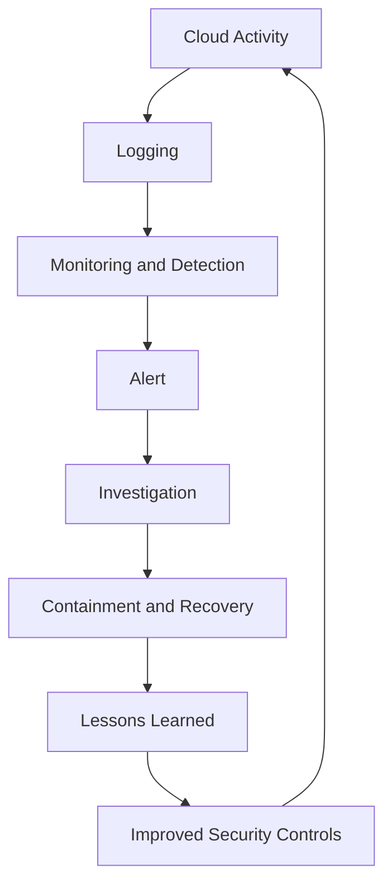

# ☁️ Understanding Cloud Logging & Monitoring

> **Cloud logging and monitoring** are security practices used to record activities, observe cloud resources, detect suspicious behavior, and investigate security incidents.

Cloud environments contain users, applications, virtual machines, databases, storage services, APIs, and network resources. Every day, these components generate events that can reveal how the environment is operating and whether something suspicious is happening.

Without effective logging and monitoring, an organization may have difficulty identifying unauthorized access, investigating data exposure, or understanding how an attacker compromised a system.

**The core idea:** Logging records what happened. Monitoring analyzes activity to identify important changes, unusual behavior, and potential threats.

---

## 1. 📋 Audit Logs

### What Are Audit Logs?

**Audit logs** are records of activities performed by users, applications, services, and administrators within an information system.

In cloud environments, audit logs help answer questions such as:

* Who performed an action?
* What action was performed?
* Which resource was affected?
* When did the action occur?
* Where did the request originate, when that information is available?
* Was the action successful or unsuccessful?

Audit logs are especially important for investigating access violations, configuration changes, privilege escalation, and suspicious API requests.

### Common Activities Recorded in Cloud Audit Logs

| Activity               | Example                                 | Security Importance                          |
| ---------------------- | --------------------------------------- | -------------------------------------------- |
| Authentication         | A user signs in to the cloud console    | Helps identify unusual login activity        |
| Access control changes | An administrator modifies an IAM policy | May reveal privilege escalation              |
| Resource creation      | A new virtual machine is launched       | Helps identify unauthorized infrastructure   |
| Storage access         | An identity reads or deletes an object  | Helps investigate potential data exposure    |
| Network changes        | A firewall rule is modified             | May reveal unexpected exposure               |
| Key management         | An access key is created or disabled    | Helps investigate credential misuse          |
| Logging changes        | Audit logging is disabled               | May indicate an attempt to reduce visibility |

### Example of an Audit Log

A simplified cloud audit event might look like this:

```json
{
  "eventTime": "2026-10-25T09:15:30Z",
  "eventName": "PutBucketPolicy",
  "userIdentity": "developer-account",
  "resource": "customer-documents",
  "sourceIPAddress": "203.0.113.25",
  "result": "Success"
}
```

**Note:** This is a fictional, simplified example. The fields and event names vary between cloud providers.

Let's understand the fields:

| Field             | Meaning                                  |
| ----------------- | ---------------------------------------- |
| `eventTime`       | When the event occurred                  |
| `eventName`       | The action performed                     |
| `userIdentity`    | The identity associated with the request |
| `resource`        | The resource affected                    |
| `sourceIPAddress` | The source IP recorded for the request   |
| `result`          | Whether the action succeeded             |

The event name `PutBucketPolicy` suggests that a storage bucket policy was changed. A security analyst would investigate the resulting policy and determine whether the change was authorized or created unintended exposure.

**Important:** An audit event alone does not prove malicious activity. Analysts need to examine the event's context and impact.

### Why Are Audit Logs Important?

Audit logs help organizations:

* Investigate suspicious activities.
* Identify unauthorized configuration changes.
* Trace actions to the associated identity.
* Support compliance and accountability.
* Reconstruct timelines during incident response.
* Detect attempts to disable security controls.

### Protecting Audit Logs

Attackers may try to modify or delete logs to conceal their actions.

To reduce this risk:

1. Restrict who can access or modify audit logs.
2. Send important logs to a separate, appropriately secured logging account or destination.
3. Use retention policies that meet operational and legal requirements.
4. Monitor changes to logging configurations.
5. Protect log integrity using appropriate controls.
6. Test whether required events are actually being recorded.

### Key Takeaway

> **Audit logs provide evidence of activity. Without reliable records, investigating a cloud incident becomes significantly more difficult.**

---

## 2. 👁️ Activity Monitoring

### What Is Activity Monitoring?

**Activity monitoring** is the continuous or periodic observation of events and behavior across cloud resources, identities, applications, and networks.

Logging records events. Monitoring examines events and their patterns to identify activity that requires attention.

For example, a cloud platform may record every successful API request. A monitoring system can analyze those requests and alert a security team when an account suddenly performs an unusually large number of administrative actions.

### What Should Be Monitored?

| Monitoring Area     | What to Observe                                                 | Possible Warning Sign                                 |
| ------------------- | --------------------------------------------------------------- | ----------------------------------------------------- |
| User activity       | Sign-ins, failed logins, session activity                       | Repeated failed logins followed by a successful login |
| Identity and access | Role assignments and policy changes                             | An ordinary account receives administrator privileges |
| Compute resources   | VM creation, resource changes, process activity where available | An unexpected instance appears                        |
| Storage             | Object access, downloads, deletions                             | An unusually large data download                      |
| Network             | Connections, traffic volume, firewall changes                   | Unexpected outbound connections                       |
| Applications        | Authentication failures, API requests, errors                   | Repeated attempts to access restricted records        |
| Security controls   | Logging, encryption, and policy changes                         | Logging is disabled unexpectedly                      |

The specific events available depend on the cloud provider, resource type, logging configuration, and monitoring tools.

### Normal Activity vs. Suspicious Activity

A security analyst needs to understand what normal behavior looks like before deciding that something is suspicious.

Consider these examples:

**Normal activity**

* A developer deploys an application during an approved release.
* A scheduled backup copies data to an authorized destination.
* An administrator modifies a firewall rule through an approved change process.

**Potentially suspicious activity**

* An administrator creates resources in an unexpected region.
* A user downloads significantly more data than usual.
* An unfamiliar identity modifies access policies outside an approved maintenance window.

These are warning signs, not automatic proof of an attack. Legitimate business operations can also produce unusual activity.

### What Is a Baseline?

A **baseline** is a description of normal system performance or behavior used for comparison.

A cloud security baseline might describe:

* Which users normally administer resources.
* Which regions an organization uses.
* Typical data-transfer volumes.
* Expected login patterns.
* Normal API request rates.
* Which services should be running.

A monitoring system can compare current activity with the baseline to identify deviations.

However, attackers can sometimes operate within normal patterns. Baselines should therefore complement, rather than replace, access controls and other security detections.

### Example: Unusual Cloud Activity

Imagine that a developer normally accesses one storage bucket containing application files.

Suddenly, the same identity starts accessing several unrelated buckets and downloading large quantities of data.

A monitoring system might:

1. Detect the increase in access activity.
2. Compare the activity with the identity's usual behavior.
3. Generate an alert.
4. Provide the relevant events to a security analyst.
5. Support investigation into whether the activity is authorized.

Depending on the evidence and the organization's response policy, the security team might revoke a credential, restrict access, or temporarily disable an account.

### Key Takeaway

> **Activity monitoring helps security teams identify behavior that may indicate a security problem before the impact becomes more severe.**

---

## 3. 🔎 Security Visibility

### What Is Security Visibility?

**Security visibility** is an organization's ability to observe and understand security-relevant activity across its systems, identities, applications, networks, and data.

Good visibility helps security teams determine what is happening in an environment and where potential risks exist.

A cloud environment can generate millions of events, but collecting only a small portion of them may leave important security gaps.

For example, an organization might monitor virtual machine performance while failing to record changes to identity permissions. The infrastructure may appear healthy even though an attacker has obtained administrative access.

### What Does Good Cloud Security Visibility Include?

* **Identity visibility:** Who can access resources and what permissions they have.
* **Activity visibility:** Which actions users and services perform.
* **Configuration visibility:** How cloud resources are configured.
* **Network visibility:** How systems communicate.
* **Data visibility:** Where sensitive information is stored and accessed.
* **Threat visibility:** Which events or behaviors may indicate malicious activity.
* **Control visibility:** Whether important security controls are enabled and functioning.

### Security Visibility vs. Logging vs. Monitoring

These concepts are related but different.

| Concept             | Main Purpose                                        | Example                                                                      |
| ------------------- | --------------------------------------------------- | ---------------------------------------------------------------------------- |
| Logging             | Record events                                       | Record that an access policy was modified                                    |
| Monitoring          | Observe and analyze activity                        | Alert when an unexpected administrator role is assigned                      |
| Security visibility | Understand activity and risk across the environment | Correlate the role change with a suspicious login and subsequent data access |

Security visibility depends on more than collecting logs. It also requires appropriate coverage, usable context, reliable data, and the ability to investigate findings.

### Common Causes of Poor Visibility

| Problem                                    | Consequence                                      |
| ------------------------------------------ | ------------------------------------------------ |
| Logging is disabled                        | Important activities may not be recorded         |
| Different systems are monitored separately | Related events are harder to correlate           |
| Logs are deleted too quickly               | Historical evidence may be unavailable           |
| Too many unimportant alerts                | Analysts may overlook serious warnings           |
| Missing identity information               | Investigators may struggle to identify the actor |
| Incomplete cloud asset inventory           | Some resources may remain unmonitored            |
| Incorrect timestamps                       | Reconstructing event sequences becomes difficult |

### Centralized Logging

Organizations often send logs from multiple cloud services to a centralized logging platform.

A simplified architecture looks like this:

```mermaid
flowchart TD
    A[Cloud Identities] --> E[Centralized Logging]
    B[Applications and APIs] --> E
    C[Virtual Machines and Networks] --> E
    D[Storage and Databases] --> E
    E --> F[Search and Correlation]
    F --> G[Alerts and Dashboards]
    G --> H[Security Analyst]
    H --> I[Investigation and Response]
```



Centralization makes it easier to search across systems and correlate related events. It should be combined with access restrictions, log-integrity protections, and appropriate retention policies.

### Tools That Improve Cloud Security Visibility

Organizations may use:

* Cloud-native audit and monitoring services.
* Security Information and Event Management (SIEM) platforms.
* Cloud Security Posture Management (CSPM) tools.
* Cloud-Native Application Protection Platforms (CNAPPs).
* Endpoint detection and response (EDR) tools.
* Network monitoring and traffic-analysis tools.

These tools serve different purposes. A SIEM focuses on collecting and correlating security events, while a CSPM tool focuses on identifying cloud configuration and posture risks. Some platforms combine multiple capabilities.

### Key Takeaway

> **You cannot reliably investigate or defend what you cannot observe. Security visibility helps connect individual events to the wider security picture.**

---

## 4. 🧾 Event Tracking

### What Is Event Tracking?

**Event tracking** is the process of recording and following specific activities or changes over time.

In cloud security, tracked events may include:

* User sign-ins and sign-outs.
* Failed authentication attempts.
* Creation and deletion of resources.
* Changes to access policies.
* Network configuration changes.
* Data access and deletion.
* Security alerts and incident-response actions.

Event tracking allows analysts to build a timeline and understand how an incident developed.

### Event Tracking vs. Audit Logging

These terms overlap, but they emphasize different things:

* **Audit logging** focuses on recording actions for accountability, security, and investigation.
* **Event tracking** focuses on following relevant events, often across time and systems, to understand a sequence or pattern.

For example, an audit log might record that a new administrator role was assigned. Event tracking can help connect that change to a preceding login, subsequent API calls, and later access to sensitive data.

### Example: Tracking a Suspicious Sequence

Suppose an attacker obtains a cloud administrator's credentials.

A simplified timeline might look like this:

| Time (UTC) | Event                                  | Security Significance                 |
| ---------- | -------------------------------------- | ------------------------------------- |
| 09:00      | Login succeeds from an unusual source  | Possible account compromise           |
| 09:02      | A new access key is created            | Possible persistence attempt          |
| 09:04      | An access policy is modified           | Possible privilege or access change   |
| 09:07      | Sensitive storage objects are accessed | Possible data exposure                |
| 09:10      | A logging setting is changed           | Possible attempt to reduce visibility |

This sequence is fictional and illustrates how events may be connected. A real investigation would verify timestamps, identities, source information, event results, and the surrounding context.

### How Event Tracking Works

1. **Collect:** Gather relevant events from cloud services and systems.
2. **Normalize:** Convert data into a consistent structure where possible.
3. **Timestamp:** Record when each event occurred, preserving timezone information.
4. **Correlate:** Connect related events using identity, resource, session, IP address, or other available identifiers.
5. **Analyze:** Determine whether the sequence indicates suspicious activity.
6. **Alert:** Notify the appropriate team when detection criteria are met.
7. **Investigate:** Validate the evidence and determine the impact.

### What Is Event Correlation?

**Event correlation** is the process of connecting multiple events to identify a larger pattern.

One failed login may be harmless. Hundreds of failed logins followed by a successful login and an unexpected privilege change may indicate a more serious problem.

Correlation helps analysts move from isolated events to a meaningful security hypothesis.

However, correlation does not automatically establish causation. Analysts must validate the sequence and rule out legitimate explanations.

### Key Takeaway

> **Individual events show what happened at a particular moment. Event tracking helps reconstruct the sequence of activities surrounding a potential incident.**

---

## 5. 🚨 Incident Investigation

### What Is a Cloud Security Incident?

A **cloud security incident** is an event or series of events that compromises, or threatens to compromise, the confidentiality, integrity, or availability of cloud resources or data.

Examples include:

* Unauthorized access to a cloud account.
* Exposure of sensitive files.
* Unauthorized changes to access policies.
* Deployment of malicious workloads.
* Compromise of a cloud-hosted application.
* Unauthorized deletion or modification of data.

Not every alert is a confirmed incident. An alert is a signal that requires assessment; an investigation determines what actually happened.

### Why Are Logs Important During an Investigation?

Logs provide evidence that can help investigators establish:

* The likely entry point.
* Which identity or service performed an action.
* Which resources were affected.
* The sequence and timing of events.
* Whether data may have been accessed or modified.
* Whether the attacker attempted to maintain access or conceal activity.
* Whether remediation was successful.

Logs are only one source of evidence. Investigators may also need configuration history, endpoint telemetry, network records, application logs, identity-provider events, and other relevant information.

### Incident Investigation Workflow

#### Step 1: Detect

An alert, report, or unusual event indicates a possible security incident.

**Example:** A cloud identity downloads an unusually large amount of data.

#### Step 2: Triage

Determine the alert's severity and whether it appears credible.

Questions to ask:

* Is the activity expected?
* Is the identity authorized to perform this action?
* Which assets could be affected?
* Is there evidence of ongoing unauthorized activity?

#### Step 3: Preserve Evidence

Protect relevant logs and records from alteration or deletion.

Record timestamps, event identifiers, affected resources, and the steps taken during the investigation.

#### Step 4: Build a Timeline

Correlate login events, API activity, permission changes, resource creation, and data access to understand the sequence.

#### Step 5: Determine Scope and Impact

Identify affected accounts, resources, systems, and data.

Assess whether credentials were compromised, permissions changed, or sensitive information may have been exposed.

#### Step 6: Contain the Threat

Follow the incident-response plan to limit further damage.

Depending on the incident, containment may involve revoking exposed credentials, disabling compromised sessions, restricting access, or isolating affected workloads.

Containment should be performed carefully to avoid unnecessary disruption or destruction of evidence.

#### Step 7: Eradicate and Recover

Remove the cause of the incident, correct the weakness, restore affected systems where necessary, and validate that the environment is secure enough to return to normal operation.

#### Step 8: Review and Improve

Document the incident, identify gaps in detection or response, and improve controls to reduce the chance of recurrence.

### Example Investigation

**Scenario:** A company receives an alert that an administrator account has changed a storage access policy.

An analyst investigates:

1. Review the audit event to identify the account, time, and resource.
2. Determine whether the change was approved.
3. Examine sign-in records for unusual authentication activity.
4. Review subsequent storage access and data-transfer events.
5. Check whether the policy exposed data to unauthorized identities.
6. Preserve relevant evidence and escalate according to the incident-response plan.
7. Restrict access or revoke compromised credentials if warranted.
8. Restore the intended policy and investigate the root cause.
9. Document the findings and improve monitoring.

The investigation should establish what the evidence supports. A policy change alone does not prove that data was accessed or stolen.

### Key Takeaway

> **Incident investigation turns security records into evidence that supports containment, recovery, and informed security decisions.**

---

## 6. 🔗 How Logging and Monitoring Work Together

Logging, monitoring, visibility, event tracking, and incident investigation are connected parts of a security process.

Consider this example:

An attacker obtains a developer's cloud credentials and accesses a storage service.

| Stage | Security Function      | What Happens                                                             |
| ----- | ---------------------- | ------------------------------------------------------------------------ |
| 1     | Audit logging          | The cloud platform records authentication and resource-access events     |
| 2     | Activity monitoring    | The system identifies unusual access patterns                            |
| 3     | Security visibility    | Analysts can examine related identity, storage, and network activity     |
| 4     | Event tracking         | Related events are correlated into a timeline                            |
| 5     | Incident investigation | Analysts determine what happened, assess impact, and coordinate response |



This is a simplified model. In practice, monitoring can use multiple data sources, and investigations may reveal gaps that require new logging or detection rules.

---

## 7. 🛠️ Common Cloud Logging and Monitoring Tools

The tools below illustrate common capabilities across major cloud platforms.

| Cloud Platform            | Service                    | Primary Purpose                                          |
| ------------------------- | -------------------------- | -------------------------------------------------------- |
| Amazon Web Services (AWS) | AWS CloudTrail             | Records supported account and API activity               |
| AWS                       | Amazon CloudWatch          | Collects and monitors metrics, logs, and alarms          |
| AWS                       | AWS Security Hub           | Helps centralize and assess security findings            |
| Microsoft Azure           | Azure Activity Log         | Records subscription-level management activities         |
| Azure                     | Azure Monitor              | Collects and analyzes monitoring data                    |
| Azure                     | Microsoft Sentinel         | Cloud-based SIEM and security orchestration platform     |
| Google Cloud              | Cloud Audit Logs           | Records supported administrative and access activities   |
| Google Cloud              | Cloud Monitoring           | Monitors metrics, resources, and application performance |
| Google Cloud              | Google Security Operations | Security analytics and investigation capabilities        |

**Important distinctions:**

* Audit services record particular types of events.
* Monitoring services analyze telemetry and help detect issues.
* SIEM platforms correlate security data across multiple sources.
* Security posture tools identify configuration and compliance risks.

Exact capabilities, service names, retention options, and pricing depend on the platform and configuration.

---

## 8. 🧪 Practical Lab: Analyze Cloud Security Events

You can learn the fundamentals without connecting to a real cloud account. Start by analyzing a fictional audit-log dataset.

### Step 1: Create a Sample Log File

Create a file named `cloud_events.json` containing:

```json
[
  {
    "time": "09:00:00",
    "user": "developer",
    "event": "ConsoleLogin",
    "resource": "cloud-console",
    "status": "Success"
  },
  {
    "time": "09:02:00",
    "user": "developer",
    "event": "CreateAccessKey",
    "resource": "developer-account",
    "status": "Success"
  },
  {
    "time": "09:04:00",
    "user": "developer",
    "event": "PutBucketPolicy",
    "resource": "customer-data",
    "status": "Success"
  },
  {
    "time": "09:07:00",
    "user": "developer",
    "event": "GetObject",
    "resource": "customer-data",
    "status": "Success"
  },
  {
    "time": "09:10:00",
    "user": "developer",
    "event": "StopLogging",
    "resource": "audit-service",
    "status": "Success"
  }
]
```

This is a fictional dataset using simplified event names and fields. It does not represent a complete or provider-validated audit-log schema.

### Step 2: Analyze the Events with Python

Create a file named `analyze_cloud_logs.py`:

```python
import json

with open("cloud_events.json", "r", encoding="utf-8") as file:
    events = json.load(file)

suspicious_events = {
    "CreateAccessKey",
    "PutBucketPolicy",
    "StopLogging"
}

for event in events:
    print(
        f'{event["time"]} | '
        f'{event["user"]} | '
        f'{event["event"]} | '
        f'{event["status"]}'
    )

    if event["event"] in suspicious_events:
        print("  REVIEW: Investigate this event.")
```

Run it in the directory containing both files:

```bash
python analyze_cloud_logs.py
```

### Step 3: Interpret the Results

The script prints each event and flags selected event types for review.

A possible review list includes:

* `CreateAccessKey`: Was the new key authorized and properly secured?
* `PutBucketPolicy`: Did the policy change expose the bucket?
* `StopLogging`: Why was logging stopped, and was the change authorized?

The script does **not** prove that an attack occurred. It is a basic rule-based exercise that illustrates how security analysts can identify events for further investigation.

### Step 4: Improve the Script

Try modifying the program to:

1. Flag failed authentication events.
2. Count events for each user.
3. Identify all events that modify security settings.
4. Save flagged events to a separate JSON or CSV file.
5. Add a timestamp and severity field to each alert.

**Professional lesson:** Simple scripts can help automate repetitive analysis, but production detection requires reliable data, suitable rules, error handling, testing, and careful management of false positives.

---

## 9. ⚠️ Common Mistakes in Cloud Logging and Monitoring

### Mistake 1: Assuming That Enabling Logs Is Enough

**Why it is wrong:** Logs that are never reviewed or analyzed may not help detect an active threat.

**Better approach:** Define monitoring rules, alert priorities, and investigation procedures.

### Mistake 2: Logging Without Protecting the Logs

**Why it is wrong:** An attacker who can modify or delete evidence may make investigation more difficult.

**Better approach:** Restrict log permissions, separate important logs from the resources they monitor, and protect log integrity.

### Mistake 3: Treating Every Alert as an Attack

**Why it is wrong:** Legitimate activity can trigger detections.

**Better approach:** Validate alerts using context and supporting evidence.

### Mistake 4: Ignoring Identity and Permission Changes

**Why it is wrong:** Unauthorized access often involves compromised credentials or unexpected privilege changes.

**Better approach:** Monitor authentication, role assignments, policy modifications, and privileged operations.

### Mistake 5: Keeping Logs for Too Little Time

**Why it is wrong:** An incident may be discovered days or weeks after the activity occurred.

**Better approach:** Establish retention periods based on risk, operational requirements, and applicable legal or regulatory obligations.

### Mistake 6: Assuming Missing Logs Mean Nothing Happened

**Why it is wrong:** Logging may have been disabled, configured incorrectly, or unavailable for the relevant activity.

**Better approach:** Check logging coverage and configuration, and treat gaps as a potential investigation limitation.

---

## 10. 🧠 Quick Revision

| Topic                  | Remember                                                                       |
| ---------------------- | ------------------------------------------------------------------------------ |
| Audit logs             | Record who performed an action, what happened, and when                        |
| Activity monitoring    | Observes and analyzes activity to identify suspicious behavior                 |
| Security visibility    | Provides an understanding of security-relevant activity across the environment |
| Event tracking         | Follows and correlates events to identify patterns and reconstruct timelines   |
| Incident investigation | Uses evidence to determine what happened, assess impact, and guide response    |

### Five Essential Questions

When investigating cloud activity, ask:

1. **Who?** Which user, application, or service performed the action?
2. **What?** What action occurred?
3. **When?** When did it happen?
4. **Where?** Which resource was affected, and what source information is available?
5. **Why?** Was the action authorized, and what evidence supports that conclusion?

The final question often requires additional investigation rather than a direct answer from a single log entry.

---

## 11. 🎯 Active Recall

Try answering these questions without looking at the note.

1. What are cloud audit logs, and why are they important?
2. What is the difference between logging and monitoring?
3. What does security visibility mean?
4. How does event correlation help identify suspicious behavior?
5. Why should audit logs be protected from modification and deletion?
6. What is the difference between a security alert and a confirmed incident?
7. How can a security analyst investigate an unexpected cloud permission change?
8. Why is it important to establish a baseline of normal activity?
9. What are the major stages of a cloud incident investigation?
10. How can Python help automate basic cloud-log analysis?

<details>
<summary>✅ Show Suggested Answers</summary>

**1. Audit logs:** Records of activities performed by users, applications, and services. They help establish what happened and support investigations.

**2. Logging vs. monitoring:** Logging records events. Monitoring observes and analyzes activity to identify issues or suspicious behavior.

**3. Security visibility:** The ability to observe and understand security-relevant activity across cloud resources and identities.

**4. Event correlation:** It connects related events across time or systems to reveal patterns that isolated events may not show.

**5. Protecting logs:** It helps preserve trustworthy evidence and prevents attackers from easily concealing their activity.

**6. Alert vs. incident:** An alert indicates that activity requires attention. Investigation determines whether a security incident occurred and what impact it had.

**7. Permission-change investigation:** Identify the actor, review the change, verify authorization, examine related authentication and resource-access events, and contain confirmed threats according to the incident-response plan.

**8. Baselines:** They help distinguish expected behavior from unusual activity, although deviations do not automatically prove an attack.

**9. Investigation stages:** Detection, triage, evidence preservation, timeline construction, scope and impact assessment, containment, eradication, recovery, and lessons learned.

**10. Python log analysis:** Python can parse structured logs, filter events, count activity, identify selected patterns, and generate review reports.

</details>

---

## 🔑 Final Takeaway

Cloud logging and monitoring help organizations move from simply operating cloud infrastructure to understanding and defending it.

* **Logging** records the evidence.
* **Monitoring** identifies activity that may require attention.
* **Visibility** provides the wider security picture.
* **Event tracking** connects related actions.
* **Incident investigation** turns evidence into decisions and response.

A strong cloud security program must also ensure that important events are actually being collected, that logs are protected, and that alerts lead to timely, evidence-based investigations.
