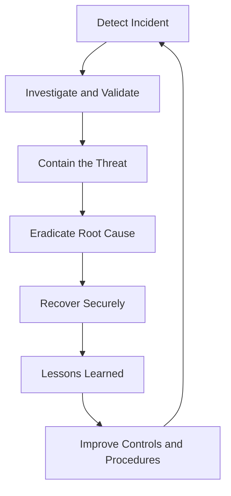

# ☁️ Understanding Cloud Incident Response

> **Cloud incident response** is the structured process of detecting, investigating, containing, and recovering from security incidents affecting cloud infrastructure, applications, identities, and data.

Cloud environments can experience incidents such as compromised accounts, exposed storage, unauthorized resource changes, malware infections, data breaches, and denial-of-service attacks.

A successful response aims to limit damage, preserve evidence, restore secure operations, and prevent similar incidents from happening again.

**Core principle:** Detect quickly, investigate carefully, contain effectively, recover securely, and learn continuously.

---

## 1. 🚨 Detecting Cloud Incidents

### What Is Incident Detection?

**Incident detection** is the process of identifying suspicious activity or events that may indicate a security incident.

Detection can be performed by automated security tools, cloud-native monitoring services, security analysts, employees, or external notifications.

An organization cannot respond effectively to an incident if it remains unaware of the incident.

### Common Cloud Security Incidents

| Incident Type             | Example                                                   | Potential Impact                        |
| ------------------------- | --------------------------------------------------------- | --------------------------------------- |
| Account compromise        | An attacker gains access to a cloud administrator account | Unauthorized control of resources       |
| Credential exposure       | An API key is published in a public repository            | Unauthorized API access                 |
| Data exposure             | A storage bucket becomes publicly accessible              | Confidential information may be exposed |
| Privilege escalation      | An identity gains unauthorized administrative permissions | Increased attacker capabilities         |
| Malware infection         | A cloud-hosted virtual machine runs malicious software    | System compromise or further intrusion  |
| Resource abuse            | An attacker creates unauthorized cloud instances          | Unexpected costs or malicious activity  |
| Denial-of-service attack  | An application receives overwhelming traffic              | Service disruption                      |
| Unauthorized modification | An attacker changes a security policy                     | Weakened security controls              |

### Sources of Incident Detection

Cloud security teams use multiple sources of information to detect suspicious behavior.

**1. Audit logs**

Record activities such as logins, API requests, permission changes, and resource creation.

**2. Security alerts**

Notify analysts when activity matches a detection rule or security finding.

**3. Identity monitoring**

Detect unusual sign-ins, suspicious authentication patterns, and unexpected privilege changes.

**4. Network monitoring**

Identify unusual connections, unexpected traffic patterns, or suspicious communication.

**5. Endpoint and workload monitoring**

Detect suspicious processes, malware indicators, or other signs of compromise on supported systems.

**6. User reports**

Employees may report phishing attempts, unexpected account activity, or suspected data exposure.

### Example: Detecting a Compromised Account

Imagine that a cloud administrator normally signs in from a familiar location and performs a limited number of administrative operations.

One day, monitoring identifies:

* A successful login from an unusual source.
* Creation of a new access key.
* An unexpected change to an access policy.
* Access to sensitive storage resources.

Each event may have a legitimate explanation individually. Together, they create a stronger reason to investigate.

### Alert vs. Security Incident

These terms are not interchangeable.

| Term              | Meaning                                                                              |
| ----------------- | ------------------------------------------------------------------------------------ |
| Event             | An observable occurrence, such as a successful login                                 |
| Alert             | A notification that an event or pattern requires attention                           |
| Security incident | An event or series of events that compromises, or threatens to compromise, security  |
| False positive    | An alert incorrectly identifies legitimate activity as suspicious                    |
| True positive     | A detection correctly identifies activity that meets its intended detection criteria |

A true-positive alert does not necessarily mean that a full security incident has been confirmed. Analysts must validate the evidence and assess the impact.

### Detection Best Practices

* Enable appropriate audit logging.
* Monitor privileged accounts and sensitive resources.
* Create alerts for important security events.
* Establish baselines for normal activity.
* Prioritize alerts according to severity and potential impact.
* Synchronize timestamps where possible.
* Regularly test detection rules.
* Ensure alerts reach the appropriate response team.

**Key takeaway:** Effective detection combines reliable telemetry, useful detection rules, and human analysis.

---

## 2. 🔎 Investigating Cloud Incidents

### What Is Incident Investigation?

**Incident investigation** is the process of collecting and analyzing evidence to understand what happened, how it happened, which resources were affected, and what actions are necessary.

Detection tells a security team that something may be wrong. Investigation helps determine what actually occurred.

### Main Investigation Questions

A cloud security analyst should ask:

* **What happened?** Identify the suspicious activity.
* **When did it happen?** Establish the timeline.
* **Who or what performed the action?** Identify the associated user, service, or workload.
* **How did it happen?** Investigate the possible entry point and attack path.
* **Which resources were affected?** Identify compromised accounts, systems, and data.
* **What was the impact?** Assess potential data exposure, modification, or service disruption.
* **Is the threat still active?** Determine whether unauthorized access may continue.
* **What evidence supports the conclusion?** Separate verified facts from assumptions.

### Common Evidence Sources

| Evidence Source           | What It Can Reveal                                              |
| ------------------------- | --------------------------------------------------------------- |
| Cloud audit logs          | API calls, identity activity, and resource changes              |
| Identity-provider logs    | Authentication attempts, sessions, and sign-in details          |
| Network logs              | Connections, traffic patterns, and communication                |
| Application logs          | Requests, errors, and application behavior                      |
| Endpoint telemetry        | Processes and other activity on supported workloads             |
| Configuration history     | Changes to policies, firewall rules, and resource settings      |
| Storage access logs       | Requests involving files or objects, where logging is available |
| Billing and usage records | Unexpected resource creation or unusual consumption             |

No single source necessarily provides the complete picture. Investigators often correlate multiple sources.

### Investigation Workflow

**Step 1: Validate the alert**

Determine whether the activity is suspicious and whether a legitimate explanation exists.

**Step 2: Identify affected assets**

Find the relevant cloud account, identity, virtual machine, application, database, or storage resource.

**Step 3: Preserve evidence**

Protect relevant logs and records. Document the time of collection, source, and actions taken.

**Step 4: Build a timeline**

Arrange relevant events chronologically to understand the sequence of activity.

**Step 5: Determine the scope**

Identify which other identities, systems, or resources may be involved.

**Step 6: Assess impact**

Determine whether the incident affected confidentiality, integrity, availability, or more than one of these security properties.

**Step 7: Decide on response actions**

Use the available evidence, incident severity, and organizational procedures to choose appropriate containment measures.

### Example: Investigating an Exposed Cloud Credential

Suppose an organization discovers that a cloud API key was accidentally published in a public repository.

An analyst should:

1. Identify the exposed credential and the permissions associated with it.
2. Revoke or disable the credential promptly.
3. Review audit logs for activity associated with the credential, where the available logs support that investigation.
4. Identify which resources were accessed or modified.
5. Determine whether data was read, changed, or deleted.
6. Check for additional credentials, identities, or resources that may have been compromised.
7. Document the timeline, findings, and remediation actions.

The investigation should not assume that the key was used simply because it was exposed. Equally, the absence of relevant log entries does not prove that no unauthorized activity occurred if logging coverage was incomplete.

### Important Investigation Principles

* Preserve evidence before making changes when doing so will not create unacceptable additional risk.
* Do not delay urgent containment merely to collect every possible artifact.
* Use authorized investigation methods.
* Document decisions and actions.
* Distinguish confirmed facts from hypotheses.
* Protect sensitive evidence and investigation records.

**Key takeaway:** A good investigation establishes a defensible understanding of the incident rather than relying on assumptions.

---

## 3. 🛑 Containment Concepts

### What Is Incident Containment?

**Containment** is the process of limiting an incident's spread and reducing further damage while the organization investigates and prepares for recovery.

Containment does not necessarily remove the root cause. Its immediate purpose is to stop or restrict ongoing unauthorized activity.

For example, disabling a compromised access key may prevent further use of that key, but investigators must still determine how it was exposed and whether other credentials were compromised.

### Why Is Containment Important?

Without containment, an attacker may continue to:

* Access sensitive information.
* Create additional credentials.
* Change security policies.
* Compromise additional workloads.
* Delete or modify resources.
* Disrupt business operations.
* Generate unauthorized cloud costs.

The right containment action depends on the incident, affected resources, available evidence, and operational requirements.

### Types of Containment

#### A. Identity Containment

Used when an account, credential, or session may be compromised.

Possible actions:

* Disable or revoke compromised credentials.
* Revoke active sessions where supported.
* Temporarily disable an affected account.
* Remove unauthorized permissions.
* Restrict access to sensitive resources.

**Example:** Revoke an exposed API key and verify whether another unauthorized key was created.

#### B. Network Containment

Used when a workload or network path may be compromised.

Possible actions:

* Restrict suspicious inbound or outbound traffic.
* Isolate an affected virtual machine using approved controls.
* Disable unnecessary network access.
* Restrict communication with affected resources.

**Example:** Isolate a compromised test server while preserving the evidence needed for investigation.

#### C. Workload Containment

Used when a virtual machine, container, or application may be compromised.

Possible actions:

* Isolate the affected workload.
* Restrict its access to sensitive services.
* Stop unauthorized processes when appropriate.
* Prevent compromised workloads from accessing additional resources.

**Example:** Restrict a compromised application instance from accessing a sensitive database while the team investigates.

#### D. Data Containment

Used when sensitive information may be exposed or improperly accessed.

Possible actions:

* Remove unintended public access.
* Restrict access to affected storage resources.
* Disable unauthorized sharing.
* Protect backups and related copies.
* Preserve evidence of the exposure.

**Example:** Correct an exposed storage policy while investigating whether unauthorized users accessed the stored files.

### Short-Term vs. Long-Term Containment

| Type                   | Purpose                                                    | Example                                           |
| ---------------------- | ---------------------------------------------------------- | ------------------------------------------------- |
| Short-term containment | Limit immediate damage                                     | Temporarily disable a compromised account         |
| Long-term containment  | Maintain a safer operating state during deeper remediation | Move a workload into a restricted network segment |

The exact distinction depends on the incident-response plan. Some organizations use different terminology.

### Containment Trade-Offs

Containment can disrupt legitimate business operations.

For example, disabling an administrator account may stop an attacker but also interrupt essential operations.

Security teams should balance:

* Risk of continued compromise.
* Business and service availability.
* Safety and legal requirements.
* Evidence preservation.
* Dependencies between affected resources.

**Important:** Containment actions should follow approved procedures and authorization requirements. In an urgent incident, predefined emergency procedures can help teams act quickly without improvising dangerous changes.

### Key Takeaway

> **Containment limits ongoing damage. It is not the same as eradicating the threat or restoring normal operations.**

---

## 4. 🔄 Recovery Concepts

### What Is Incident Recovery?

**Recovery** is the process of restoring affected systems, services, identities, and data to a secure and operational state after an incident.

Recovery should not simply return a system to its previous condition if that condition contained the weakness that enabled the incident.

The goal is to restore service while addressing the security problems that caused or contributed to the incident.

### Main Recovery Activities

#### 1. Remove the Root Cause

Examples include:

* Correcting insecure cloud configurations.
* Removing unauthorized accounts or credentials.
* Patching exploited vulnerabilities.
* Fixing application authorization weaknesses.
* Removing malicious software from affected workloads.

#### 2. Restore Systems and Data

Use trusted backups, verified images, or clean deployments when appropriate.

Before restoring data, determine whether the backup or image was created before the compromise and whether it is trustworthy.

#### 3. Rebuild Compromised Workloads When Necessary

A severely compromised virtual machine may be safer to replace with a clean, trusted image than to attempt to repair every possible modification.

This decision depends on the available evidence, operational needs, and recovery plan.

#### 4. Validate Identity and Access Controls

* Replace compromised credentials.
* Review permissions.
* Confirm that unauthorized access paths are closed.
* Verify that privileged access is restricted.
* Check relevant workload identities and secrets.

#### 5. Restore Services Gradually

Where practical, restore services in stages and monitor them closely for signs of renewed compromise.

#### 6. Verify Security Controls

Confirm that logging, monitoring, access restrictions, backups, and other required controls are functioning.

#### 7. Monitor for Recurrence

Continue heightened monitoring according to the incident's risk and the organization's response plan.

### Recovery vs. Containment vs. Eradication

| Phase       | Main Goal                            | Example                                                                    |
| ----------- | ------------------------------------ | -------------------------------------------------------------------------- |
| Containment | Limit ongoing damage                 | Revoke a compromised access key                                            |
| Eradication | Remove the threat and its root cause | Remove unauthorized access and fix the exposed credential-handling process |
| Recovery    | Restore secure operations            | Redeploy a clean application and verify its controls                       |

These phases are related and may overlap in practice, but they represent different objectives.

### Example: Recovering from a Cloud Account Compromise

Suppose an attacker compromises a cloud administrator account and modifies access policies.

A recovery plan might include:

1. Confirm that the attacker's access has been contained.
2. Remove unauthorized identities, keys, and policy changes.
3. Reset or rotate affected credentials.
4. Review the environment for additional persistence mechanisms.
5. Restore approved access policies.
6. Verify logging and monitoring coverage.
7. Validate critical workloads and data integrity.
8. Restore normal operations in a controlled manner.
9. Monitor for further suspicious activity.

Simply changing the administrator's password may not be sufficient if the attacker created another access key, modified a trust relationship, or established another method of access.

### What Is a Recovery Point?

A **recovery point** is a state to which data or a system can be restored.

The **Recovery Point Objective (RPO)** describes the maximum targeted amount of data loss measured in time that an organization is willing to tolerate after a disruption.

The **Recovery Time Objective (RTO)** describes the target time within which a system or service should be restored.

| Concept | Question It Answers                                     |
| ------- | ------------------------------------------------------- |
| RPO     | How much data loss, measured in time, can we tolerate?  |
| RTO     | How long can we tolerate the service being unavailable? |

These objectives help organizations design backup, replication, and recovery strategies. Actual recovery performance depends on the environment and the incident.

### Key Takeaway

> **Successful recovery restores service and verifies security. Bringing a system back online is not enough if the original compromise can happen again.**

---

## 5. 📚 Lessons Learned

### What Are Lessons Learned?

**Lessons learned** is the process of reviewing an incident and its response to identify what worked, what failed, and what should change.

The purpose is to improve the organization's security posture and incident-response capability—not simply to assign blame.

Even when an incident is contained successfully, it may reveal weaknesses in detection, access control, procedures, training, or recovery planning.

### Questions to Ask After an Incident

**About detection**

* How was the incident discovered?
* Could it have been detected earlier?
* Were the right logs available?
* Did alerts reach the right people?

**About investigation**

* Was the evidence sufficient?
* Were timestamps and event sources reliable?
* Were the scope and impact understood correctly?
* Were important assumptions tested?

**About containment**

* Did containment happen quickly enough?
* Were the selected actions effective?
* Did containment cause avoidable service disruption?

**About recovery**

* Were trusted backups or images available?
* Was the root cause corrected?
* Were security controls verified before normal operations resumed?
* Did suspicious activity recur?

**About the organization**

* Were responsibilities clear?
* Were escalation procedures effective?
* Did teams have the necessary permissions and training?
* Should the incident-response plan be updated?

### Common Improvements

| Finding                                  | Possible Improvement                                            |
| ---------------------------------------- | --------------------------------------------------------------- |
| Exposed credentials were discovered late | Add secret scanning and improve credential-management practices |
| Privilege changes were not detected      | Add monitoring for sensitive IAM changes                        |
| Logs were incomplete                     | Improve audit-log coverage and retention                        |
| Response was delayed                     | Clarify escalation paths and on-call responsibilities           |
| Recovery took too long                   | Test backups and automate safe deployment procedures            |
| Permissions were too broad               | Review roles and apply least privilege                          |
| The same incident happened again         | Verify that corrective actions address the root cause           |

### Conducting a Post-Incident Review

A useful review should produce concrete actions.

For each action, record:

* The problem identified.
* The corrective action.
* The responsible team or role.
* The priority.
* The target completion date.
* How the team will verify the fix.

For example:

**Finding:** An exposed API key was used before the team detected the incident.

**Corrective actions:**

1. Introduce automated secret scanning.
2. Reduce the lifetime and permissions of API credentials.
3. Create alerts for suspicious key creation and usage.
4. Test the new detections with authorized simulations.
5. Review the results and document remaining gaps.

The review should also record what went well so that successful response practices can be repeated.

### Why a Blameless Review Matters

People may hide mistakes if every incident leads to punishment without examining the underlying process.

A constructive review focuses on facts, accountability, and system improvements. Deliberate misconduct can still require appropriate organizational action, but learning should not stop at blaming one individual.

### Key Takeaway

> **An incident should produce improvements that reduce the likelihood or impact of future incidents.**

---

## 6. 🔗 The Complete Cloud Incident-Response Lifecycle

The five topics work together as a continuous process.



This is a simplified lifecycle. Real incidents may require teams to revisit earlier stages as new evidence emerges. For example, investigation often continues during containment and recovery.

### Example: A Cloud Storage Exposure

Imagine that a company discovers a storage bucket containing confidential documents is publicly accessible.

| Phase           | Example Action                                                              |
| --------------- | --------------------------------------------------------------------------- |
| Detection       | A configuration alert identifies public access                              |
| Investigation   | Analysts review the policy, access records, and affected data               |
| Containment     | The team restricts unintended public access                                 |
| Eradication     | The team corrects the underlying configuration and access-control process   |
| Recovery        | The team verifies the intended access model and restores affected workflows |
| Lessons learned | The team adds preventive checks and tests configuration monitoring          |

The organization should investigate whether unauthorized access occurred rather than assuming that public exposure necessarily means the data was downloaded.

---

## 7. 🧪 Practical Lab: Respond to a Cloud Security Incident

### Scenario

You are a junior cloud security analyst.

Your monitoring system generates an alert indicating that a cloud administrator's account may have been compromised.

You discover the following fictional events:

| Time (UTC) | Event                                   |
| ---------- | --------------------------------------- |
| 10:00      | Successful login from an unusual source |
| 10:02      | New access key created                  |
| 10:04      | Storage access policy modified          |
| 10:06      | Sensitive files accessed                |
| 10:08      | Audit logging configuration changed     |

Your task is to create an incident-response plan.

### Step 1: Detection

Identify the suspicious indicators:

* Unusual login.
* New access key.
* Unexpected policy modification.
* Access to sensitive files.
* Change to audit logging.

**Question:** Why is this sequence more concerning than a single unusual login?

### Step 2: Investigation

Determine:

* Which identity performed each action.
* Whether the login and policy change were authorized.
* Which files were accessed.
* Whether logging was interrupted.
* Whether additional credentials or resources were affected.

Preserve available evidence and document any gaps in the records.

### Step 3: Containment

Potential actions, based on the evidence and approved procedures:

* Revoke the suspicious access key.
* Revoke compromised sessions where supported.
* Restrict the affected account or its permissions.
* Restore appropriate logging.
* Restrict unintended access to sensitive storage.

Containment may need to begin before the investigation is complete if the threat is active.

### Step 4: Recovery

* Remove unauthorized access changes.
* Rotate affected credentials.
* Review identity policies.
* Validate data integrity and service availability.
* Confirm that monitoring is operating correctly.
* Continue monitoring for suspicious activity.

### Step 5: Lessons Learned

Recommend improvements, such as:

* Alerts for unusual administrator activity.
* Monitoring for new access-key creation.
* Restrictions on who can change audit logging.
* Least-privilege access policies.
* Tested emergency-response procedures.

### Your Deliverable

Write a short report using this template:

```text
Cloud Incident Response Report

1. Incident Summary:
   What happened?

2. Detection:
   How was the incident discovered?

3. Evidence:
   Which logs or records support the findings?

4. Scope and Impact:
   Which accounts, resources, or data may be affected?

5. Containment:
   What actions were taken to limit further damage?

6. Eradication:
   How was the root cause removed?

7. Recovery:
   How were secure operations restored and verified?

8. Lessons Learned:
   What should be improved?

9. Remaining Risks:
   What is still unknown or needs further investigation?
```

**Professional note:** This is a fictional exercise. In a real environment, follow the organization's incident-response plan, authorization requirements, evidence-handling procedures, and escalation rules.

---

## 8. ⚠️ Common Incident-Response Mistakes

### Mistake 1: Waiting for Complete Proof Before Containing an Active Threat

**Why it is risky:** An attacker may continue accessing resources while the team investigates.

**Better approach:** Use risk-based containment and preserve evidence where practical.

### Mistake 2: Deleting a Compromised Resource Immediately

**Why it is risky:** Destroying a workload may remove valuable evidence or make the incident harder to understand.

**Better approach:** Follow evidence-preservation procedures unless immediate action is necessary to prevent greater harm.

### Mistake 3: Changing Only the Password

**Why it is risky:** Other credentials, sessions, access keys, or persistence mechanisms may remain active.

**Better approach:** Investigate the full identity and access context.

### Mistake 4: Restoring From an Unverified Backup

**Why it is risky:** A backup may contain compromised software, malicious changes, or already-exposed data.

**Better approach:** Select and validate a trustworthy recovery source.

### Mistake 5: Returning to Normal Operations Too Early

**Why it is risky:** The attacker may retain access, or the original weakness may still exist.

**Better approach:** Verify remediation and security controls before restoring normal operations.

### Mistake 6: Skipping the Post-Incident Review

**Why it is risky:** The same weakness may cause another incident.

**Better approach:** Assign, track, and verify corrective actions.

---

## 9. 🧠 Quick Revision

| Stage           | Main Question                              | Primary Goal                           |
| --------------- | ------------------------------------------ | -------------------------------------- |
| Detection       | Is something suspicious happening?         | Identify potential incidents           |
| Investigation   | What happened, and what is affected?       | Establish facts and scope              |
| Containment     | How do we limit further damage?            | Restrict ongoing threats               |
| Eradication     | How do we remove the threat and its cause? | Eliminate the compromise               |
| Recovery        | How do we restore secure operations?       | Return services to a verified state    |
| Lessons learned | What should change?                        | Improve future prevention and response |

### Five Essential Principles

1. **Detect early:** Reliable logs and useful alerts reduce the time before a threat is discovered.
2. **Investigate with evidence:** Establish what happened instead of relying on assumptions.
3. **Contain according to risk:** Limit damage while considering operational impact.
4. **Recover securely:** Remove the root cause and verify that controls work before returning to normal.
5. **Learn continuously:** Convert incident findings into measurable security improvements.

---

## 10. 🎯 Active Recall

Try answering these questions without looking at the note.

1. What is cloud incident response?
2. What is the difference between an event, an alert, and a security incident?
3. Which evidence sources can help investigate a compromised cloud account?
4. Why should investigators build an incident timeline?
5. What is containment, and how does it differ from eradication?
6. Give three examples of cloud containment actions.
7. What is the difference between recovery and simply bringing a system back online?
8. Why should backups be validated before recovery?
9. What is the purpose of a post-incident review?
10. How can an organization reduce the likelihood of the same cloud incident occurring again?

<details>
<summary>✅ Show Suggested Answers</summary>

**1. Cloud incident response:** A structured process for detecting, investigating, containing, and recovering from cloud security incidents while improving future security.

**2. Event, alert, and incident:** An event is an observable occurrence. An alert signals that something requires attention. A security incident compromises, or threatens to compromise, security.

**3. Evidence sources:** Cloud audit logs, identity-provider records, network logs, application logs, workload telemetry, configuration history, and storage-access records.

**4. Incident timeline:** It helps establish the order of events, identify possible entry points, understand attacker actions, and assess impact.

**5. Containment vs. eradication:** Containment limits ongoing damage. Eradication removes the threat and addresses its root cause.

**6. Containment examples:** Revoking compromised credentials, restricting suspicious network traffic, and removing unintended public access.

**7. Secure recovery:** Recovery requires restoring services while verifying that the root cause has been addressed and the environment is safe to operate.

**8. Backup validation:** It helps prevent restoration of compromised or untrustworthy systems and data.

**9. Post-incident review:** It identifies successful practices and weaknesses, then converts findings into corrective actions.

**10. Preventing recurrence:** Improve access controls, configuration management, monitoring, incident procedures, testing, and security training based on the findings.

</details>

---

## 🔑 Final Takeaway

Cloud incident response is more than reacting to an alert. It is a disciplined process for understanding an incident, limiting its impact, restoring secure operations, and improving the organization's defenses.

A capable cloud security professional should always ask:

* **Can we detect the incident quickly?**
* **Can we establish what happened from reliable evidence?**
* **Can we contain the threat without causing unnecessary damage?**
* **Can we recover without reintroducing the original weakness?**
* **Can we turn the incident into a measurable security improvement?**

These questions form the foundation of effective cloud incident response.
