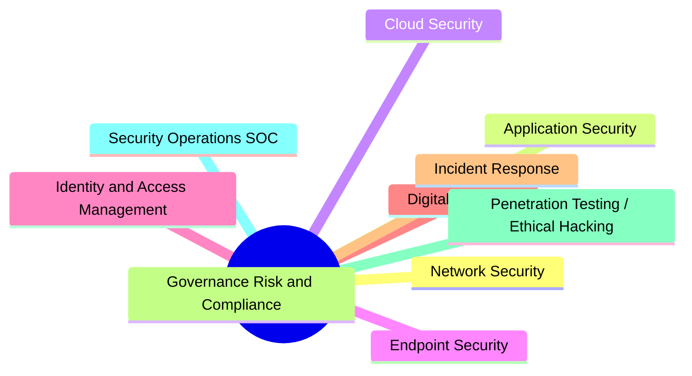
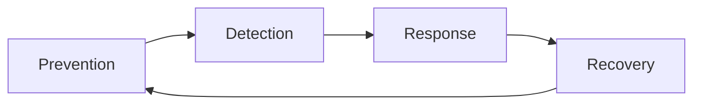
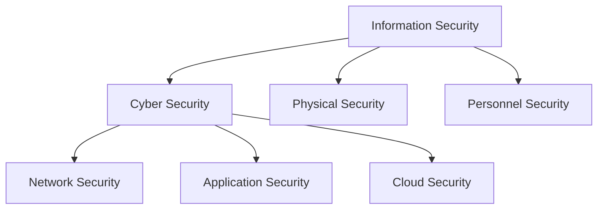

# Cyber Security Fundamentals

## Overview

This document covers the foundational concepts of Cyber Security — what it is, why it matters, how it differs from Information Security, the major domains within the field, and the modern threat landscape. This is Module 1 of the Cyber Security learning path.

---

## Table of Contents

- [Learning Objectives](#learning-objectives)
- [Prerequisites](#prerequisites)
- [Theory](#theory)
- [Detailed Explanation](#detailed-explanation)
  - [What is Cyber Security](#a-what-is-cyber-security)
  - [Why Cyber Security is Important](#b-why-cyber-security-is-important)
  - [Information Security vs Cyber Security](#c-information-security-vs-cyber-security)
  - [Cyber Security Domains](#d-cyber-security-domains)
  - [Modern Threat Landscape](#e-modern-threat-landscape)
- [Real-World Example](#real-world-example)
- [Industry Use Cases](#industry-use-cases)
- [Mermaid Diagrams](#mermaid-diagrams)
- [Common Mistakes](#common-mistakes)
- [Security Best Practices](#security-best-practices)
- [Interview Questions](#interview-questions)
- [Practice Questions](#practice-questions)
- [MCQs](#mcqs)
- [Cheat Sheet](#cheat-sheet)
- [Quick Revision](#quick-revision)
- [Summary](#summary)
- [References](#references)

---

## Learning Objectives

By the end of this module, you should be able to:

- [ ] Define Cyber Security in your own words
- [ ] Explain why Cyber Security matters using a real-world scenario
- [ ] Differentiate between Information Security and Cyber Security
- [ ] List and describe at least 5 major Cyber Security domains
- [ ] Identify common threat actors and modern attack trends

---

## Prerequisites

None — this is an entry-level foundational module.

---

## Theory

> 🛡️ **Cyber Security** is the practice of protecting systems, networks, devices, and data from unauthorized access, damage, theft, or disruption.

Cyber Security is not just "hacking." It is a full lifecycle:

1. **Prevention** – Stopping attacks before they happen (firewalls, strong passwords)
2. **Detection** – Noticing malicious activity (monitoring, IDS/IPS)
3. **Response** – Reacting properly during an incident
4. **Recovery** – Returning to normal operations (backups, disaster recovery)

---

## Detailed Explanation

### a. What is Cyber Security

Cyber Security protects digital assets the same way physical security protects a house — locks (access control), cameras (monitoring), a safe (encryption), and a watchful neighbor (incident response).

Key point: **Ethical hacking (offensive security) is only one part of Cyber Security.** The larger discipline includes defense, monitoring, response, and recovery.

### b. Why Cyber Security is Important

> ⚠️ A single breach can cause financial loss, legal penalties, reputational damage, and in critical sectors (healthcare, energy), even loss of life.

| Without Security | Consequence |
|---|---|
| No password policy | Accounts get hacked easily |
| No encryption | Data theft during transmission |
| No patching | Old vulnerabilities exploited |
| No backups | Ransomware = total data loss |
| No monitoring | Attackers stay hidden for months |

📌 Cybercrime costs the global economy trillions of dollars annually, and this figure trends upward year over year (treat as an order-of-magnitude fact — exact numbers vary by source/year).

### c. Information Security vs Cyber Security

> 💡 Cyber Security is a **subset** of Information Security.

| Aspect | Information Security | Cyber Security |
|---|---|---|
| Scope | All forms of data (digital + physical) | Only digital/electronic data |
| Focus | CIA Triad (Confidentiality, Integrity, Availability) | Protecting networks, systems, devices from cyber attacks |
| Example | Locking a filing cabinet, shredding documents | Firewalls, antivirus, penetration testing |
| Relationship | Broader concept | Subset of InfoSec |

**Example:**
- Stealing a **paper file** from an office cabinet → Information Security breach only.
- Hacking an HR **database** to steal the same data → Both Information Security AND Cyber Security breach.

The **CIA Triad** (Confidentiality, Integrity, Availability) underlies all of InfoSec and will be covered in full detail in the next module.

### d. Cyber Security Domains

| Domain | Focus | Typical Entry Job Role |
|---|---|---|
| Network Security | Firewalls, VPNs, IDS/IPS | Network Security Engineer |
| Application Security (AppSec) | Securing software/web apps, OWASP Top 10 | AppSec Engineer, Web Pentester |
| Cloud Security | AWS/Azure/GCP security | Cloud Security Engineer |
| Endpoint Security | Laptops, mobiles, servers (AV, EDR) | Endpoint Security Analyst |
| Identity and Access Management (IAM) | Authentication & authorization | IAM Engineer |
| Digital Forensics | Post-incident investigation | Forensic Analyst |
| Incident Response (IR) | Real-time attack handling | IR Analyst |
| Governance, Risk & Compliance (GRC) | Policies, audits, ISO 27001, GDPR | GRC Analyst/Auditor |
| Penetration Testing / Ethical Hacking | Legal, authorized attack simulation | Pentester, Red Teamer |
| Security Operations Center (SOC) | 24/7 monitoring | SOC Analyst (common fresher entry point) |

> ✅ **Career tip:** Most freshers enter the field through **SOC Analyst** or **Junior Pentester/VAPT** roles. Prioritize Network Security, SOC concepts, and Web App Security for fastest job-readiness.

### e. Modern Threat Landscape

**Threat Actors:**

| Threat Actor | Motivation | Example |
|---|---|---|
| Script Kiddies | Fun, fame, low skill | Using pre-made tools without understanding |
| Hacktivists | Political/social cause | Anonymous-style attacks |
| Cybercriminals | Money | Ransomware gangs, phishing scams |
| Insider Threats | Revenge, money, mistake | Disgruntled employee leaking data |
| Nation-State Actors | Espionage, sabotage | APT groups (Advanced Persistent Threats) |

**Top Modern Attack Trends:**

- **Ransomware** – Encrypting data and demanding payment
- **Phishing / Social Engineering** – The human remains the weakest link
- **Supply Chain Attacks** – Compromising a trusted vendor to reach the real target (e.g., SolarWinds)
- **Cloud Misconfigurations** – Open S3 buckets, exposed databases
- **AI-powered attacks** – AI-generated phishing, deepfake scams, automated recon
- **Zero-day exploits** – Attacks on unpatched, unknown vulnerabilities

> ⚠️ Note: This module intentionally covers attack **categories and concepts only** — not execution techniques. Hands-on practice happens later in safe, legal lab environments (TryHackMe, HackTheBox).

---

## Real-World Example

**WannaCry Ransomware (2017)** hit the UK's NHS hospitals, cancelling thousands of surgeries and appointments because hospital computers were locked by ransomware — demonstrating how a cyber attack can have life-threatening, real-world consequences, not just financial ones.

---

## Practical Example

Think about one app or service you personally use daily (banking app, email, social media). Ask yourself:
- What data does it hold about you?
- What would happen if it were breached?

This is the beginning of **threat modeling**, a concept we'll formalize later.

---

## Industry Use Cases

- **Banks** invest heavily in Network Security + IAM to protect financial transactions.
- **Hospitals** prioritize Endpoint Security + Backups after incidents like WannaCry.
- **Tech companies (SaaS)** focus on AppSec + Cloud Security due to cloud-native infrastructure.
- **Government agencies** focus on GRC + Nation-State threat defense.

---

## Mermaid Diagrams

### Cyber Security Domains Mind Map

### Security Lifecycle

### InfoSec vs Cyber Security Relationship

---

## Common Mistakes

- ❌ Thinking Cyber Security = only hacking/pentesting
- ❌ Using "Information Security" and "Cyber Security" interchangeably in interviews without knowing the distinction
- ❌ Ignoring non-technical domains like GRC, thinking they're "not real security work"
- ❌ Believing only large companies get attacked (small businesses are frequent targets due to weaker defenses)
- ❌ Assuming phishing is an "old" or "solved" threat

---

## Security Best Practices

- ✅ Always think in terms of the full lifecycle: Prevent → Detect → Respond → Recover
- ✅ Map every security control back to the CIA Triad
- ✅ Stay updated on current threat trends (follow CVE feeds, security blogs)
- ✅ Practice in legal, authorized lab environments only (TryHackMe, HTB, DVWA)
- ✅ Understand attacker motivations to better anticipate their methods

---

## Interview Questions

1. What is the difference between Information Security and Cyber Security?
2. Why is Cyber Security important for a modern business?
3. Name and explain 5 domains of Cyber Security.
4. What is a threat actor? Name different types.
5. Explain the difference between a threat, vulnerability, and risk (preview — covered fully next module).
6. Why is phishing still effective despite increased awareness?
7. Give an example of a supply chain attack and explain why it's dangerous.
8. What is the CIA Triad? (preview)

---

## Practice Questions

1. In your own words, explain why Cyber Security is a subset of Information Security.
2. List 3 cyber security domains and identify one job role for each.
3. Describe one real-world cyber attack and map it to a threat actor category.
4. Explain the 4-stage security lifecycle (Prevent, Detect, Respond, Recover) using a non-technical analogy of your own.

---

## MCQs

**Q1. Which of the following best describes Cyber Security?**
A. Only hacking into systems
B. Protecting digital systems, networks, and data from unauthorized access
C. Writing antivirus software only
D. Managing employee HR records

> **Answer: B**

**Q2. Information Security is:**
A. A subset of Cyber Security
B. Unrelated to Cyber Security
C. A broader concept that includes Cyber Security
D. Only about paper documents

> **Answer: C**

**Q3. Which threat actor is primarily financially motivated?**
A. Hacktivist
B. Script Kiddie
C. Cybercriminal
D. Nation-State Actor

> **Answer: C**

**Q4. Which attack type involves compromising a trusted vendor to reach the real target?**
A. Phishing
B. Supply Chain Attack
C. Zero-day Exploit
D. Ransomware

> **Answer: B**

**Q5. Which of these is typically the most common entry-level role for freshers?**
A. Chief Information Security Officer (CISO)
B. SOC Analyst
C. Red Team Lead
D. Cloud Security Architect

> **Answer: B**

---

## Cheat Sheet

| Term | One-Line Meaning |
|---|---|
| Cyber Security | Protecting digital systems/networks/data |
| Information Security | Protecting information in any form (digital + physical) |
| CIA Triad | Confidentiality, Integrity, Availability |
| SOC | Team that monitors systems 24/7 for threats |
| GRC | Governance, Risk, Compliance |
| APT | Advanced Persistent Threat (nation-state level attacker) |
| Zero-day | Vulnerability with no available patch yet |

---

## Quick Revision

- Cyber Security = Prevent + Detect + Respond + Recover
- InfoSec is broader than Cyber Security; Cyber Security is a subset
- CIA Triad underlies all security controls (Confidentiality, Integrity, Availability)
- 10 major domains: Network, AppSec, Cloud, Endpoint, IAM, Forensics, IR, GRC, Pentesting, SOC
- Threat actors: Script Kiddies, Hacktivists, Cybercriminals, Insiders, Nation-States
- Modern threats: Ransomware, Phishing, Supply Chain Attacks, Cloud Misconfigs, AI-powered attacks, Zero-days

---

## Summary

Cyber Security is the practice of protecting digital systems and data through a continuous lifecycle of prevention, detection, response, and recovery. It is a subset of the broader field of Information Security, which also covers physical and verbal information protection. The field is divided into multiple specialized domains — from Network Security to GRC — each with distinct roles in industry. Understanding the modern threat landscape, including threat actor types and current attack trends like ransomware, phishing, and supply chain attacks, is essential groundwork before moving into technical, hands-on training.

---

## References

- NIST Cybersecurity Framework – https://www.nist.gov/cyberframework
- OWASP Foundation – https://owasp.org
- ENISA Threat Landscape Reports – https://www.enisa.europa.eu
- TryHackMe (practice labs) – https://tryhackme.com
- HackTheBox (practice labs) – https://hackthebox.com

---

**Suggested filename:** `Cyber_Security_Fundamentals.md`
